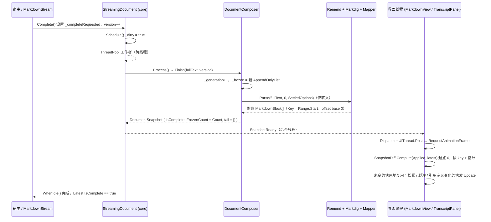

# 流结束（`Complete()`）后的整篇重解析与新的一代

**Trigger:** 宿主调用 `StreamingDocument.Complete()`（会话场景经 `MarkdownStream.Complete()` / 条目完成）  **Outcome:** 整篇重新解析一次，跨片段的引用定义 / 脚注 / 列表松紧被修正，产生 `IsComplete = true` 的最终快照；内容未变的块不被重建（差异比对跳过共享前缀，跨代不跳）

**工作区状态：** `src/StreamMark.Avalonia/Extensions` 与 `src/StreamMark.Avalonia/Rendering` 的在飞改动**在本次运行中途被提交为 `cd7a2a8`**（"Diff view: unified and split modes"；`git show --stat cd7a2a8`）；此后 `git status --short` 只剩 submodule `native/ratex` 的 modified content，这两个目录相对 HEAD 是干净的。该提交只新增 `diff` / `patch` 围栏视图（`src/StreamMark.Avalonia/Rendering/DiffBlockView.cs`、`src/StreamMark.Core/Diff/UnifiedDiff.cs`）与 `CodeBlockOptions` 的 diff 选项（`DiffMode` / `DiffSplitMinWidth` / `DiffModeText`，`CollapseText` 改成 `Func<string>`），**没有改动 `Complete()` 之后的任何一步**；本页引用的所有文件与行号都已按 `cd7a2a8` 重新核对。

## Steps

1. `src/StreamMark.Avalonia/MarkdownStream.cs:MarkdownStream.Complete` — 会话场景的入口：在界面线程上置 `_completeRequested`、`_pacer.Finish(StreamClock.Now)`；不平滑或积压已排空时立刻 `Finish()`，否则让 16ms 计时器把积压放完（`MarkdownStream.Tick`，同文件 `:92`） (`avalonia-text-rendering`)
2. `src/StreamMark.Core/Pacing/StreamPacer.cs:StreamPacer.Finish` — 结束标记只影响节奏：剩余积压在 `MinDrain`–`MaxDrain`（180–520ms）内放完，`Tick` 继续返回文本（`IsDrained`，同文件 `:97`） (`core-streaming`)
3. `src/StreamMark.Avalonia/MarkdownStream.cs:MarkdownStream.Finish` — 积压为 0 后真正收尾：`_timer.Stop()` → `Document.Complete()` → `State.IsActive = false` → 触发 `Completed` 事件（同文件 `:34`、`:114-120`） (`avalonia-text-rendering`)
4. `src/StreamMark.Core/Streaming/StreamingDocument.cs:StreamingDocument.Complete` — 核心侧只做两件事：在 `_sourceLock` 下置 `_completeRequested = true`、`_version++`，然后 `Schedule()`；重复调用直接返回，不重复排工作 (`core-streaming`)
5. `src/StreamMark.Core/Streaming/StreamingDocument.cs:StreamingDocument.Schedule` — 只置 `_dirty = true`；若已有工作者在跑就返回（**解析进行中到达的完成请求只留脏标记**），否则 `_running = true` 并 `ThreadPool.UnsafeQueueUserWorkItem(self => self.Run())`
6. ⇢ crosses **thread** boundary via `ThreadPool.UnsafeQueueUserWorkItem`（界面线程 → 线程池线程；`StreamingDocument` 是 Core 程序集，不引用 Avalonia）
7. `src/StreamMark.Core/Streaming/StreamingDocument.cs:StreamingDocument.Run` → `StreamingDocument.Process` — 收了脏标记后先比版本：`_sourceGeneration` 与 `_composerGeneration` 不同则 `_composer.Reset()`；`version == _processedVersion` 或 `_finished` 时返回 null（**没有新版本就不重解析**）；否则取 `complete = _completeRequested`，并令 **`from = complete ? 0 : _composer.FrozenEnd`**（`:276`）——整篇，而不是从冻结边界起 (`core-streaming`)
8. `src/StreamMark.Core/Streaming/StreamingDocument.cs:StreamingDocument.Process` — 先 `_processedVersion = version`、`_finished = true`，再 `return _composer.Finish(text, version)`（`:280-285`）；注意整篇源码是在 `_sourceLock` 下 `_source.ToString(0, Length)` 拷出来的（`:277`），此后 Append 已被禁止
9. `src/StreamMark.Core/Streaming/DocumentComposer.cs:DocumentComposer.Finish` — 开启新一代：`_generation++`（`:96`）并把 `_frozen` 换成**全新的** `AppendOnlyList`（`:97`），所以 `DocumentSnapshot.SharesFrozenWith`（`src/StreamMark.Core/Streaming/DocumentSnapshot.cs:55`）在跨代时必然为 false——上一代的冻结前缀不再被共享（快照本身不新建 `DocumentComposer`，见 `src/StreamMark.Core/Streaming/StreamingDocument.cs:263` 的 `Reset` 分支只发生在 `Reset()` 之后）
10. `src/StreamMark.Core/Streaming/DocumentComposer.cs:DocumentComposer.Finish` — 整篇 `Parse(fullText, 0, SettledOptions)` 一次，把结果全部塞进 `_frozen`，`tail = []`、`SourceLength = FrozenSourceEnd = fullText.Length`、`isComplete: true`（`:98-102`）；`FrozenCount == Count`，即流结束后没有"尾部"可言 (`core-streaming`)
11. `src/StreamMark.Core/Streaming/DocumentComposer.cs:DocumentComposer.SettledOptions` — 整篇重解析用的 remend 选项**只留与位置无关的转义修正**：`Bold/BoldItalic/Italic/InlineCode/Strikethrough/Katex/InlineKatex/Links/Images/HtmlTags/SetextHeadings = false`，剩下的 `SingleTilde` 与 `ComparisonOperators` 为 true（`:21-34`）。与尾部路径 `_tailOptions`（`RemendOptions.Default` + 插件 handler，`:42-48`）刻意不同——已完整的文本不该被"补全" (`remend-and-offsetmap`)
12. `src/StreamMark.Core/Streaming/DocumentComposer.cs:DocumentComposer.Parse` → `src/StreamMark.Core/Remend/Remend.cs:Remend.Complete` — 对整篇做一次 remend（`Complete` 幂等，`:211`），再 `Markdig.Parse(healed, _profile.Pipeline)`，最后 `MarkdigMapper.MapDocument(document, _profile, OffsetMap.Create(0, raw, healed))`（`:111-116`）：offset map 的 `_base = 0`，把修补后文本的位置映回整篇源码 (`remend-and-offsetmap`)
13. `src/StreamMark.Core/Parsing/MarkdigMapper.cs:MarkdigMapper.Map` — 引用定义在这一步被"消化掉"：`LinkReferenceDefinitionGroup` / `LinkReferenceDefinition` / `BlankLineBlock` 映射为 `null`（`:190`），定义块本身不产生渲染块；它的效果体现在其它块的 `InlineContent.Links` 上（`src/StreamMark.Core/Model/InlineContent.cs:LinkTarget`，`:36`） (`core-parsing-and-model`)
14. `src/StreamMark.Core/Parsing/MarkdigMapper.cs:MarkdigMapper.MapFootnotes` — 整篇解析才能出现的 `FootnoteGroup` → `FootnotesBlock`（`:185`、`:309-319`）；行内引用侧是 `FootnoteLink` 分支：`AddLink("#fn:" + label)` + `InlineStyle.FootnoteReference | Superscript`（`:461-465`） (`core-parsing-and-model`)
15. `src/StreamMark.Core/Parsing/MarkdigMapper.cs:MarkdigMapper.MapList` — 列表松紧来自整篇判定：`MdListBlock.IsLoose` 直接进模型（`:253`，`src/StreamMark.Core/Model/Blocks.cs:ListBlock` 的 `IsLoose` 在 `:96`、进指纹在 `:103`） (`core-parsing-and-model`)
16. `src/StreamMark.Core/Parsing/MarkdigMapper.cs:MarkdigMapper.MapDocument` — 每条 `MarkdownBlock.Range` 用 `RangeOf` + `OffsetMap.ToSource` 映回整篇源码（`:198-214`，`src/StreamMark.Core/Parsing/OffsetMap.cs:ToSource`），`Key => Range.Start`（`src/StreamMark.Core/Model/Blocks.cs:18`）因此与流式期间同一个块一致 (`core-parsing-and-model`)
17. ⇢ crosses **thread** boundary via `StreamingDocument.SnapshotReady`（`Action<DocumentSnapshot>`，后台线程触发，`src/StreamMark.Core/Streaming/StreamingDocument.cs:50`）；`Run` 用 `Volatile.Write(ref _latest, snapshot)` 发布后再触发（`:230-231`）
18. `src/StreamMark.Core/Streaming/StreamingDocument.cs:StreamingDocument.TakeWork` — 脏标记已被消费，`_running = false` 并 `_idle?.TrySetResult()` 唤醒 `WhenIdle()`（`:237-253`）；此时 `Latest.IsComplete == true`（`src/StreamMark.Core/Streaming/DocumentSnapshot.cs:44`），`StreamingDocument.IsComplete`（`:52`）也为 true (`core-streaming`)
19. `src/StreamMark.Avalonia/MarkdownView.cs:MarkdownView.OnSnapshotReady` — 界面线程侧：事件处理只 `Dispatcher.UIThread.Post(RequestFrame, DispatcherPriority.Render)`，绝不在后台线程碰控件（`:138`） (`avalonia-text-rendering`)
20. `src/StreamMark.Avalonia/MarkdownView.cs:MarkdownView.RequestFrame` — 每帧最多一次：`TopLevel.RequestAnimationFrame(_ => ApplyLatest())`（`:140-156`） (`avalonia-text-rendering`)
21. `src/StreamMark.Avalonia/Rendering/DocumentPresenter.cs:DocumentPresenter.Apply` — `SnapshotDiff.Compute(Applied, snapshot)` 拿到 `DiffOp` 列表后逐条应用（`:30-80`）。单条消息控件（`MarkdownView`）走这条路：`Insert` 建视图，`Update` 时 `BlockViewFactory.CanReuse` 通过就原地 `view.Update(...)`，否则移除重建（`:48-66`） (`avalonia-text-rendering`)
22. `src/StreamMark.Core/Streaming/SnapshotDiff.cs:SnapshotDiff.Compute` — **差异从头比对**：跨代时 `previous.SharesFrozenWith(next)` 为 false，起点是 `0` 而不是 `Math.Min(FrozenCount)`（`:28`）；但比对仍按 **key 归并 + 指纹判定**——同 key 且 `!ReferenceEquals` 且「类型不同 ‖ `Range` 不同 ‖ `ComputeFingerprint()` 不同」才发 `Update`（`:35-45`），否则因为内容未变而不产生任何操作，视图原样保留。指纹见 `src/StreamMark.Core/Model/Blocks.cs:MarkdownBlock.ComputeFingerprint`（`:23`，FNV-1a，`src/StreamMark.Core/Model/Fingerprint.cs:Fingerprint`），`AddContent` 覆盖行内文本 / span 样式 / 链接 URL / 行内对象 / `IsLoose` 等 (`core-streaming`、`core-parsing-and-model`)
23. `src/StreamMark.Avalonia/Transcript/TranscriptPanel.cs:TranscriptPanel.OnSnapshotReady` → `TranscriptPanel.ApplyAll` — 会话路径同样每帧一次（`:203-217`），把行摊平后按 `op.Index` 换算 `rowStart` 再对行做 `Insert` / `UpdateBlockRows` / `Remove`（`:250-319`）；`state.Applied = latest` 之后 `RefreshRealizedContexts` 只更新上下文变化的已实现视图（`:482-491`） (`avalonia-transcript`)
24. `src/StreamMark.Avalonia/Transcript/TranscriptPanel.cs:TranscriptPanel.UpdateBlockRows` — `Update` 分段数变化时增删行（`ChunkCount`，`:500-516`：折叠的代码块 / 大代码块分段），并把 `updated.Block = block` 后交给 `UpdateView` 复用视图（`:415-450`） (`avalonia-transcript`)
25. `src/StreamMark.Avalonia/Rendering/ContainerViews.cs:ListBlockView` — **列表松紧的呈现**：整篇判定翻成 loose 后，`ListBlock` 的指纹变化只发一条 `Update`，`ListBlockView` 被原地复用（`BlockViewFactory.CanReuseBuiltIn`，`src/StreamMark.Avalonia/Rendering/BlockViewFactory.cs:65`），随后 `_items[i].Tight = !_list.IsLoose`（`:119`）与 `ItemSpacing`（`:166`：loose 用 `Style.BlockSpacing`，tight 用 4）生效，**不是重建列表** (`avalonia-text-rendering`)
26. `src/StreamMark.Avalonia/Rendering/ContainerViews.cs:ListBlockView` 与 `src/StreamMark.Avalonia/Rendering/ContainerViews.cs:FootnotesBlockView` — **脚注的呈现**：整篇解析后 `FootnotesBlock` 才（以正确的 label / order）出现，`FootnotesBlockView` 把每条脚注包成 `ListItemBlock(null, footnote.Children)` 渲染（`:297-298`）；正文里的 `[^x]` 因为 `InlineSpan.Style` 多了 `FootnoteReference` 而指纹改变，段落发一条 `Update`，`TextBlockView` 复用、`TextSegmentView.Set` 重排 (`avalonia-text-rendering`)
27. `src/StreamMark.Avalonia/Rendering/TextSegmentView.cs:TextSegmentView.Set` — 段落内容变化时不要整段重排：`FirstDifference`（`:191`）算出公共前缀，然后**从差异点所在段落起点**失效 `TextRunCache.InvalidateFrom(paragraphStart)`（`:162-176`）。跨代重解析若把段落文本变了（例如 `[^1]` 变成上标引用），这里就是局部重排而非整体重建 (`avalonia-text-rendering`)
28. `src/StreamMark.Avalonia/Rendering/TextSegmentView.cs:TextSegmentView.Render` — **光标消失**：末尾光标只在 `streaming.IsActive == true` 时画（`:472`），而 `MarkdownStream.Finish` 已把 `StreamingState.IsActive` 置 false（`src/StreamMark.Avalonia/Rendering/StreamingState.cs:21`、`src/StreamMark.Avalonia/MarkdownStream.cs:118`）；渐显靠 `StreamingState.GetFadingTail` 的时间窗自然结束 (`avalonia-text-rendering`)
29. `src/StreamMark.Avalonia/Rendering/CodeBlockView.cs:CodeBlockView.OnUpdate` — 未闭合代码块（流式手工构造的 `CodeBlock { IsOpen: true }`）在整篇重解析后变成闭合块：`code.IsOpen` 时写入 `ExpandedState = true`（`:199-203`）避免刚写完的代码突然折叠，而 `IsCollapsible` 要求 `!code.IsOpen`（`:130-131`），所以**可折叠 / 可换成图表视图只在完成后才成立**（`BlockViewFactory.ViewTypeFor` 的 `CodeBlock { IsOpen: false }` → `Diagram`，`src/StreamMark.Avalonia/Rendering/BlockViewFactory.cs:95`） (`avalonia-text-rendering`)
30. `src/StreamMark.Avalonia/Plugins/PluginRegistry.cs:PluginRegistry.FindFenceView` — 与之无关的另一类"完成后换视图"：注册了 `whileStreaming: true` 的围栏视图（如 `diff` / `patch` → `DiffBlockView`，`src/StreamMark.Avalonia/Plugins/BuiltInComponentsPlugin.cs:31`）在 `IsOpen` 时也命中（`:62-65`），所以 `IsOpen` 只区分内置的 code / diagram 分支，不阻挡插件围栏视图 (`avalonia-plugin-system`)
31. `src/StreamMark.Avalonia/Transcript/TranscriptEntry.cs:MarkdownEntry.EnsureParsed` — 另一条**同步**完成路径：延迟解析的历史条目在界面线程调 `Document.LoadNow(text)`（`:48-54`），而 `LoadNow` 在调用线程上直接 `Process()` 并 `SnapshotReady?.Invoke`（`src/StreamMark.Core/Streaming/StreamingDocument.cs:126-160`）——同一段 `DocumentComposer.Finish` 代码，但重解析发生在界面线程上 (`avalonia-transcript`、`core-streaming`)
32. `src/StreamMark.Core/Streaming/StreamingDocument.cs:StreamingDocument.Append` — **Complete 之后的 Append 抛异常**（`:73-76`：`InvalidOperationException`，提示 `call Reset() before appending`）；恢复路径只有 `Reset(text?)`（`:99-113`，`_sourceGeneration++` → `Process` 里 `_composer.Reset()` 开新代）与 `Load`（`:116-120`，= `Reset + Complete`）。`MarkdownStream.Push` 则是**静默丢弃**（`src/StreamMark.Avalonia/MarkdownStream.cs:44-47`），不抛异常 (`core-streaming`)

## Sequence

## Errors and cancellation

- 没有取消：`StreamingDocument` / `DocumentComposer` 与 `src/StreamMark.Core` 全库都不接受 `CancellationToken`（`Grep CancellationToken` 在 `src/StreamMark.Core` 下无命中）。一旦 `Complete()` 排上工作，整篇重解析一定跑到结束。
- 与流式路径**共用同一处**异常处理：`Run` 里 `catch (Exception ex)` → `Debug.WriteLine("StreamMark: parse failed: …")` → `snapshot = null`，不向上抛、不中断（`src/StreamMark.Core/Streaming/StreamingDocument.cs:222-227`）；因此流式期间"界面停了"和完成时"界面停在最后一个不完整快照"是同一种失败表现。
- 完成路径的失败是**终局**的：`Process` 在调用 `Finish` **之前**就写了 `_processedVersion = version` 与 `_finished = true`（`:280-284`），异常被吞掉之后 `TakeWork` 结束工作者（`:237-253`）；`Complete()` 因为 `_completeRequested` 已为 true 直接返回（`:88-91`），再调也不会重试。`Latest` 会永远停在最后一个 `IsComplete == false` 的快照上，`WhenIdle()` 反而正常完成——**不能把 `WhenIdle()` 当作"解析成功"的信号**，要判 `Latest.IsComplete`。
- `MarkdownStream` 侧的失败模式不同：`Push` 在 `_completeRequested` 之后静默 return（`src/StreamMark.Avalonia/MarkdownStream.cs:44-47`）；而 `StreamingDocument.Append` 会抛（`:73-76`）。所以同一个"流结束后又来了文本"在两条路径上一个丢一个炸。
- `LoadNow` 的失败会**同步抛给界面线程**（`Process()` 在调用线程上跑，`src/StreamMark.Core/Streaming/StreamingDocument.cs:147`），且它在进入时会预占 `_running`，异常路径靠 `finally` 里的 `TakeWork()` 把工作者的占位还回去（`:153-159`）。
- 图片来源 / 排版缓存等 Avalonia 侧的失败不在本流程的 catch 内，会以正常的 Avalonia 异常冒到单帧渲染里。

## Where to hook in

- **改整篇解析用的 remend 选项** → `DocumentComposer.SettledOptions`（`src/StreamMark.Core/Streaming/DocumentComposer.cs:21`）。**别**给整篇加上末尾补全：已完成文本会被"补"出多余标记，且冻结片段（同用 `SettledOptions`，`:69`）与整篇会不一致，`StreamingEquivalenceTests.EverySnapshot_MatchesFullParseOfPrefix` 的 `AssertSameBlocks` 会报指纹不符（`tests/StreamMark.Core.Tests/Streaming/StreamingEquivalenceTests.cs:105-118`、`:68-70`）。插件的补全只能走 `MarkdownProfileBuilder.AddRemendHandler`（`src/StreamMark.Core/Parsing/MarkdownProfile.cs:99`），它只进尾部选项（`DocumentComposer.cs:46`），整篇重解析不跑。
- **新增"只在整篇才能确定"的语法**（跨片段引用 / 脚注 / 定义列表等）→ 在 `StreamSegmenter` 里把它变成"不再冻结"的守卫（`src/StreamMark.Core/Streaming/StreamSegmenter.cs:41`、`:273-307`），并把规则写进 `docs/streaming-rules.md:9-20`。漏掉守卫 → 冻结片段与整篇不一致，等价性测试红。
- **改差异判定** → `SnapshotDiff.Compute`（`src/StreamMark.Core/Streaming/SnapshotDiff.cs:24`）与模型的 `AddContent`（`src/StreamMark.Core/Model/Blocks.cs:31`、`InlineContent.AddTo`，`src/StreamMark.Core/Model/InlineContent.cs:118`）：只给块加**影响渲染**的字段才进指纹。往模型加字段却忘了加进 `AddContent` → 完成后该字段变了却不发 `Update`，界面停留在旧内容（例如新样式字段）。
- **新增一种 `DiffKind`** → `byte` 枚举 `DiffKind`（`src/StreamMark.Core/Streaming/SnapshotDiff.cs:5`）有**两份** `switch` 消费：`src/StreamMark.Avalonia/Rendering/DocumentPresenter.cs:35` 与 `src/StreamMark.Avalonia/Transcript/TranscriptPanel.cs:277`，必须同步改，否则新操作被静默忽略。
- **给完成事件加行为** → `MarkdownStream.Completed`（`src/StreamMark.Avalonia/MarkdownStream.cs:34`、`:119`）是公开且当前仓库内**无人订阅**的钩子；注意它在界面线程、且在 `Document.Complete()` 之后立刻触发，此刻 `Latest` 仍是**上一个**快照（新的还在线程池上），要读最终结果请 `await Document.WhenIdle()` 或订阅 `SnapshotReady`。
- **不要做的**：不要在 `SnapshotReady` 处理函数里同步做重活（契约要求尽快返回，`src/StreamMark.Core/Streaming/StreamingDocument.cs:49`）；不要绕过 `SnapshotDiff` 直接重建全部视图（会丢掉"未变块不重建"的保证，且丢掉 `CodeBlockView` 的折叠 / 展开状态与选区片段编号）；不要试图在 `Complete()` 之后 `Append`（抛）或指望 `MarkdownStream.Push` 报错（静默丢弃）。
- **测试位置**：`tests/StreamMark.Core.Tests/Streaming/StreamingEquivalenceTests.cs:35`（每步快照 == 前缀整篇解析，`:68-70` 是 `Finish` 的整篇一致性与 `IsComplete`）、`:90`（`ReferenceDefinitions_ResolveAfterFinish`：引用定义 + `FootnoteReference` 在 `Finish` 后生效）、`StreamingDocumentTests.cs:10`（`Complete` 后 `IsComplete`、再 `Append` 抛）、`:35`（`Reset` 换代、跨代差异先 Remove 后 Insert）、`SnapshotDiffTests.cs:31`（`Finish` 的差异可重放）、`:70`（冻结本身不产生 Update）；界面侧 `tests/StreamMark.Avalonia.Tests/Rendering/ChatFeatureTests.cs:180`（流式代码块完成后不折叠）、`tests/StreamMark.Avalonia.Tests/Rendering/SelectionAndFadeTests.cs:72-74`（`Complete` 后 `IsActive == false`）；端到端 `samples/StreamMark.Gallery/SmokeTest.cs:56`（`document.Complete()` → `IsComplete` / `SourceLength` / 块类型 / 差异条数）。

## Related

- Modules: [core-streaming](../modules/core-streaming.md)
- Modules: [remend-and-offsetmap](../modules/remend-and-offsetmap.md)
- Modules: [core-parsing-and-model](../modules/core-parsing-and-model.md)
- Modules: [avalonia-text-rendering](../modules/avalonia-text-rendering.md)
- Modules: [avalonia-transcript](../modules/avalonia-transcript.md)
- 与本流程相邻的还有 [streaming-token-to-view](./streaming-token-to-view.md)（同一批视图，但走 `Update` 的流式路径）与 [transcript-virtualization-scroll](./transcript-virtualization-scroll.md)（行摊平 / 锚定）。
- 背景记录：`docs/decisions.md:10`（为什么只在结束时整篇重解析）、`docs/streaming-rules.md:20`（出现定义后停止冻结）、`docs/streaming-rules.md:45`（冻结片段与整篇只用转义修正）。
- 备注：`streaming-token-to-view.md` 已存在于本目录（与 `cd7a2a8` 同批提交）；`transcript-virtualization-scroll.md` 尚未出现 (unverified)。
