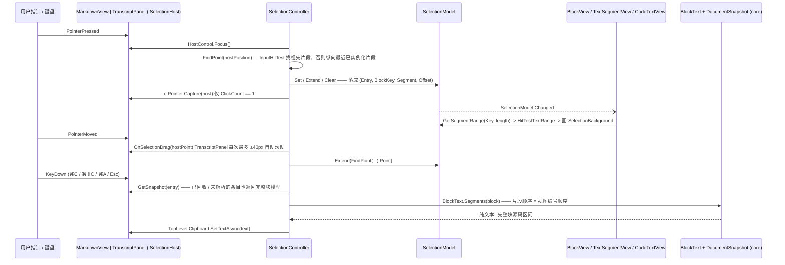

# 从指针按下到剪贴板 —— 跨消息的文字选择与复制

**Trigger:** 用户在 `MarkdownView` 或 `TranscriptView`（内部是 `TranscriptPanel`）上按下指针：单击 / 拖拽 / 双击 / 三击 / Shift 单击（`SelectionController.OnPressed`，`src/StreamMark.Avalonia/Selection/SelectionController.cs:58`）  **Outcome:** 选区只以与视图无关的四个整数 `(Entry, BlockKey, Segment, Offset)` 保存（`Selection/TextPoint.cs:8`），被虚拟化回收或从未实例化的块仍在选区内；⌘C 得到纯文本（公式还原为 `$latex$`、表格制表符、列表前缀），⌘⇧C 得到**选区覆盖的完整块**的 Markdown 源码；两者都经 `Clipboard.SetTextAsync(string)` 写入系统剪贴板。

> 工作区状态：本页按 HEAD `cd7a2a8` 写，行号已与之核对。写作期间并发改动落到了 `Rendering/DiffBlockView.cs` 等文件（`git status`：`native/ratex` 指针 + 未跟踪的 `.agents/`；`git log` 已出现 `a72b840`）。`git diff --numstat cd7a2a8 -- <路径>` 对本流程涉及的全部路径均为空（`Selection/*`、`Transcript/*`、`Rendering/TextSegmentView.cs`、`Rendering/BlockView.cs`、`Rendering/CodeBlockView.cs`、`Rendering/DiagramBlockView.cs`、`Rendering/MathBlockView.cs`、`Rendering/TableBlockView.cs`、`Rendering/ContainerViews.cs`、`Plugins/BuiltInComponentsPlugin.cs`、`MarkdownView.cs`、`Core/Model/Blocks.cs`），唯一被改动的是 `DiffBlockView.cs`（`git diff --stat`：`DiffBlockView.cs | 187 ++++…`，同目录 `flows/transcript-virtualization-scroll.md` 亦记录此事）。本页所有行号取自 `cd7a2a8`；对该提交是否顺带移动了本页引用的其它文件的行号，本次**未逐行核对** (unverified)。

## Steps

1. `src/StreamMark.Avalonia/MarkdownView.cs:MarkdownView`（构造函数 :48）— 单文档视图在构造时 `new SelectionController(this)`（:63），自己就是 `ISelectionHost`（`Control ISelectionHost.HostControl => this`，:233；`GetSnapshot(entry)` 只认 `entry == 0` 并返回 `_presenter.Applied`，:241；`GetSource` 走 `EffectiveDocument.GetText(start, length)`，:243）；`Render` 里铺一层透明矩形，"块与块之间的空白也能开始拖拽选择"（:227-231）(`avalonia-text-rendering`、`avalonia-selection`)
2. `src/StreamMark.Avalonia/Transcript/TranscriptPanel.cs:TranscriptPanel`（构造函数 :82）— 会话面板同样在构造时 `new SelectionController(this)`（:88），`Background = Brushes.Transparent` 让空白处也能起拖拽（:87）；`TranscriptView` 只做透传：`Selection => Panel.Selection`、`SelectionController => Panel.SelectionController`（`Transcript/TranscriptView.cs:30`、`:32`）(`avalonia-transcript`)
3. `Selection/SelectionController.cs:SelectionController`（构造函数 :46）— 四个处理器挂在宿主控件上：`PointerPressed`（`handledEventsToo: false`）、`PointerMoved`（`true`）、`PointerReleased`（`true`）、`KeyDown`（`false`）（:50-53）(`avalonia-selection`)
4. `Selection/SelectionController.cs:OnPressed` — 只处理左键（`point.Properties.IsLeftButtonPressed`，:61），先 `_host.HostControl.Focus()` 抢焦点（⌘C 才有 `KeyDown` 可接，:65），再做 **`FindPoint(point.Position) is not { } hit` → `Selection.Clear(); return`**（:66-70）；命中后按 `e.ClickCount` 分三支（:72-91）(`avalonia-selection`)
5. `Selection/SelectionController.cs:FindPoint` — 命中测试两级：先 `control.InputHitTest(hostPoint)` 做可视树点命中，沿 `GetSelfAndVisualAncestors()` 向上找第一个 `ISelectableSegment`（:273-287，遇 `control` 即停，:282）——图片 / 公式 / 复选框这些 `DrawableTextRun` 占据的矩形落在 `TextSegmentView` 的可视区域内，所以命中它们的祖先**正是该文本片段**，偏移由 `segment.HitTest(local)` 给出（:279-280）；点不到片段时退回"纵向最近的**已实例化**片段"：遍历 `_host.RealizedSegments()`，跳过 `!segment.View.IsEffectivelyVisible` 的（:295），取 `origin.Y` 距离最小者（:300-311），指针在片段上方给 offset 0、下方给 `best.Text.Length`、同高则按 `best.HitTest` 横向命中（:316-328），一个都没有就返回 `null`（:312-315）(`avalonia-selection`、`avalonia-text-rendering`)
6. `Selection/SelectionController.cs:OnPressed` 的三支判定与顺序 — `case 2`：`WordAt(segment.Text, position.Offset)` 选词（:74-77，`WordAt` 内部先 `Math.Clamp(offset, 0, text.Length - 1)` 再取 `IsLetterOrDigit || '_'` 连续段，落在非词字符上只给 `(offset, offset + 1)`，`WordAt` :332-355）；`case >= 3`：整片段 `(0, segment.Text.Length)`（:78-80）；**默认支才看 Shift**：`Selection.Anchor is not null` 时 `Selection.Extend(position)`，否则 `Selection.Set(position, position)`（:81-90）(`avalonia-selection`)
7. `Selection/SelectionController.cs:OnPressed` 尾部 — `_dragging = e.ClickCount == 1`（:92），只有单击进入拖拽态，双击 / 三击不会开始拖拽（:93-96 `e.Pointer.Capture(_host.HostControl)`）(`avalonia-selection`)
8. `Selection/SelectionModel.cs:SelectionModel.Set` / `.Extend` / `.Clear` — 值落进唯一的两个字段 `_anchor` / `_active`（:9-10），值未变时不触发事件，否则各触发一次 `Changed`（`Set` :35-44、`Extend` :46-58、`Clear` :60-69）；`Extend` 在 `_anchor is null` 时先把 anchor 设成同一个点（:48-51）；派生的 `Range`（anchor/active 归一化成 `(Start, End)`，:21-33）与 `IsEmpty`（含 `anchor == active`，即单击无选中，:15）都不持久化(`avalonia-selection`)
9. `src/StreamMark.Core/Model/Blocks.cs:MarkdownBlock.Key` — 坐标里的 `BlockKey` 是 `Range.Start`（:18，`SourceRange(int Start, int Length)` 定义在 :6），即块在源码中的起始偏移；`Selection/TextPoint.cs:6` 的注释给出稳定性根据："源码只追加，所以这些坐标在流式重解析之间保持有效"；`Entry` 维就是 `RenderContext.Entry`（`Rendering/RenderContext.cs:41`，会话里的消息序号）(`core-parsing-and-model`、`core-streaming`)
10. `Selection/SelectionController.cs:OnMoved` — 只有 `_dragging` 为真才处理（:101-104）：先 `_host.OnSelectionDrag(e.GetPosition(_host.HostControl))`（:106），再 `FindPoint(position)` 命中就把返回值里的 `Point`（即 `best.Key.At(offset)` / 祖先片段的 `segment.Key.At(...)`）`Selection.Extend` 成新的 active（:107-110）(`avalonia-selection`)
11. `Transcript/TranscriptPanel.cs:TranscriptPanel.OnSelectionDrag` — 自动滚动：只有指针穿出宿主坐标才会滚且单次最多 40px——`hostPoint.Y < 0` 时 `SetOffsetInternal(_offset.Y + Math.Max(hostPoint.Y, -40))`，`> _viewport.Height` 时 `+ Math.Min(hostPoint.Y - _viewport.Height, 40)`（:958-968）；`SetOffsetInternal` 会清 `_pendingAnchor` 并触发 `ScrollInvalidated`（:909-925）(`avalonia-transcript`)
12. `Rendering/RenderContext.cs:RenderContext.Selection` — 选区实例随上下文一起下发到每个块视图（构造参数 :14、属性 :38）；`MarkdownView.CreateContext()` 传 `Selection`（`MarkdownView.cs:170`），`TranscriptPanel.ContextFor` 同样把面板的 `Selection` 塞进每条消息的上下文（`TranscriptPanel.cs:238`）(`avalonia-text-rendering`、`avalonia-transcript`)
13. ⇢ crosses **event** 边界 via `SelectionModel.Changed`（`Action`，`Selection/SelectionModel.cs:13`）— 视图订阅这一条事件来重绘高亮：`TextSegmentView.Set` 里上下文或选区实例变化时退订 / 订阅（:149-160），挂树时补订阅（:233-240）、离树时退订（:242-248），处理器 `OnSelectionChanged() => InvalidateVisual()`（:263）；`CodeTextView.Set` 直接用方法组订阅 `context.Selection.Changed += InvalidateVisual`（`CodeBlockView.cs:477`，挂树 :755、离树 :770）；`MathBlockView`（:139 / :148）、`DiffBodyView`（`DiffBlockView.cs:887` / `:902`）同形(`avalonia-selection`、`avalonia-text-rendering`)
14. `Rendering/TextSegmentView.cs:TextSegmentView.Render` — 重绘时**按片段身份**取区间并只画矩形，不触发重新排版：`GetSegmentRange(Key, _content.Text.Length) is { } selected` → `layout.HitTestTextRange(selected.Start, selected.End - selected.Start)` → `FillRectangle(_context.Style.SelectionBackground, rect)`（:450-456）；`CodeTextView.Render` 把全局区间按行拆成本行区间、并把跨行处的行尾补半格宽矩形（`CodeBlockView.cs:630`、:639-658）；`MathBlockView` 只有"选中/未选中"两态（`GetSegmentRange(...) is not null`，`MathBlockView.cs:96`、:100-102 与 :112-115 分别给公式版与源码版）(`avalonia-text-rendering`)
15. `Selection/SelectionModel.cs:GetSegmentRange` — 查询语义：`key.Segment < 0` 立即返回 null（:74-78，负编号片段不参与选区），区间与片段无交也返回 null（:81-84），否则返回 `[start, end)`（:85-87）；`(end > start) ? (start, end) : null` 使"选区端点落在片段边界上"不画高亮(`avalonia-selection`)
16. `Selection/SelectionController.cs:OnReleased` — 拖拽收尾：`_dragging = false` 并 `e.Pointer.Capture(null)`（:113-121）；此后 `OnMoved` 不再扩展选区(`avalonia-selection`)
17. `Rendering/TextSegmentView.cs:TextSegmentView.OnPointerReleased` — 命中测试之外的点击路由（**与复制路径并列，不在 `avalonia-selection` 内**）：先要求 `_context is { Selection.IsEmpty: true }`（:817-820，选区非空时直接 return，拖拽选中不会被当成点击），然后图片槽 → 组件 → 链接逐级判断（:822-869）(`avalonia-text-rendering`)
18. `Selection/SelectionController.cs:OnKeyDown` — 热键判定顺序：`platform?.Copy.Any(g => g.Matches(e))`（平台配置缺失时回落到 "C + Control"，:125-126）→ `Copy && !Selection.IsEmpty` 时 `e.Handled = true` 并 `await CopyAsync(asMarkdown: e.KeyModifiers.HasFlag(KeyModifiers.Shift))`（:128-132）；`platform?.SelectAll`（:127）命中则 `SelectAll()`（:133-137）；`Key.Escape` 清空（:138-141）(`avalonia-selection`)
19. `Selection/SelectionController.cs:CopyAsync` — 形态只有一个参数决定：`asMarkdown ? GetSelectedMarkdown() : GetSelectedText()`（:171），文本非空且 `TopLevel.GetTopLevel(_host.HostControl)?.Clipboard` 取到时才 `await clipboard.SetTextAsync(text)`（:172-175）；全仓库只写纯文本一种剪贴板格式，没有 HTML / 自定义 MIME（同形调用另有三处块内"复制"按钮：`CodeBlockView.cs:276-280` 复制整块代码、`DiagramBlockView.cs:47-53` 复制图表源码、`TableBlockView.cs:37-43` 复制 `ToMarkdown(table)`）(`avalonia-selection`、`avalonia-transcript`、`avalonia-text-rendering`)
20. `Selection/SelectionController.cs:GetSelectedText` — 纯文本收集（主循环 :187-225）：按 `range.Start.Entry` … `range.End.Entry` 逐个 `_host.GetSnapshot(entry)`，**取不到就 `continue`**（:189-192，`MarkdownView` 之外的消息序号、`ContentEntry` 都返回 null）；块过滤用 `blockEnd < range.Start || blockStart > range.End` 跳过不相交的块（:195-200，其中 `blockStart`/`blockEnd` 就是同一 `BlockKey` 下的 `TextPoint` 边界）；片段区间**按下标从模型重算** `new SegmentKey(entry, block.Key, i)`（:204）(`avalonia-selection`)
21. `Selection/SelectionController.cs:GetSelectedText` 的区间算术与拼接 — `s` 取"选区头已在片段之前 → 0 / 已在片段之后 → -1 / 否则取 `range.Start.Offset`"，`e` 同理（:206-207），随后 **`s < 0 || e < 0 || e < s || (e == s && segment.Length > 0)` 全部 continue**（:208-211，`e == s && segment.Length > 0` 就是"端点在一段末尾与下一段开头重合时不插入多余分隔符"）；拼接规则：非首片段时 `i == 0 ? "\n\n" : segment.Separator`（块间空行、块内片段用自己的分隔符，:212-216），只有 `s == 0`（片段开头被选中）才加 `segment.Prefix`（:217-220，列表标记 / 脚注序号靠它），文本由 `segment.Slice(s, e, ComponentText)` 产出（:221，`:214` 注释即"块与块之间空一行，块内片段之间按片段自身的分隔符"）(`avalonia-selection`)
22. `Selection/BlockText.cs:BlockText` — 唯一"块模型 → 片段列表 / 纯文本"的提取器：`Segments(block)` → `Collect(block, list, "")`（:32-37），`Collect` 的 `switch` 定义阅读顺序（段落 / 标题 / 代码 / 公式 / HTML 各 1 段，:43-57；表格按行优先、首列 `"\n"` 其余 `"\t"`，:58-67；提示块 / 引用 / 自定义容器用空前缀、HTML 盒子继承 `prefix`，:68-85 与 :97-102；`ComponentBlock` 先 `summary` 再其余子块，:86-96；列表每项首个片段带 `"[x] " / "[ ] " / "{StartNumber + i}. " / "- "`，:103-118；脚注 `"[order] "`，:119-127；定义列表每项先术语后释义，:128-140）(`core-parsing-and-model`)
23. `Selection/BlockText.cs:PlainText` — 行内占位替换：U+FFFC（`InlineObject.Placeholder`）按对象种类替换成 `$$latex$$` / `$latex$`、图片 `Alt`、`[x]` / `[ ]`，组件则先问宿主的插件（`InlineObjectKind.Component => components?.Invoke(obj) ?? …`，:167-174），`components` 就是 `SelectionController.ComponentText` → `_host.Plugins?.FindInlineComponent(obj.Value)?.ToPlainText(obj)`（`SelectionController.cs:229`，实现例 `Plugins/BuiltInComponentsPlugin.cs:236`）(`avalonia-selection`、`avalonia-plugin-system`)
24. `Selection/SelectionController.cs:GetSelectedMarkdown` — ⌘⇧C 的路径：对每个 entry 的 `snapshot.Blocks` 用同样的 `blockStart/blockEnd` 排除不相交块（:246-253），只累加块级 `block.Range` 的 `Math.Min(start, …)` / `Math.Max(end, …)`（:254-255），`end > start` 时才写上：非首个 entry 之间插 `"\n\n"`（:259-262），文本来自 `_host.GetSource(entry, start, end - start).TrimEnd()`（:263）；`start/end` 初值 `int.MaxValue / -1` 保证无重叠块时返回空串（:245、:257）。因为取的是块级 `Range`，**部分选中的段落 / 列表 / 代码块都会整块带出来**，且不会裁到嵌套子块级别(`avalonia-selection`)
25. `src/StreamMark.Avalonia/Transcript/TranscriptPanel.cs:TranscriptPanel.ISelectionHost.GetSnapshot` — 被虚拟化回收（`row.View = null`，`Unrealize` :691-701）或从未实例化的块仍可复制：`RealizedSegments()` 只枚举 `_rows` 里有 `BlockView` 的行（:931-932，仅命中测试用），而 `GetSnapshot(entry)` 返回与视图无关的 `state.Applied`（:952）；该条目是按需解析且未解析时，就地 `markdown.EnsureParsed()`（`Transcript/TranscriptEntry.cs:48-54`，`Interlocked.Exchange` 保证只解析一次）→ `RequestFrame()` → 直接返回 `markdown.Document.Latest`（:945-951）(`avalonia-transcript`、`core-streaming`)
26. `src/StreamMark.Core/Streaming/StreamingDocument.cs:StreamingDocument.GetText` — Markdown 源码输出的最后一跳：在 `_sourceLock` 下把 `start` / `length` 夹进 `_source` 再 `ToString(start, length)`（:175-183）；面板侧只做序号与类型检查（`entry is MarkdownEntry markdown ? markdown.Document.GetText(start, length) : ""`，`TranscriptPanel.cs:955-956`），`MarkdownView` 侧走 `EffectiveDocument?.GetText(...) ?? ""`（`MarkdownView.cs:243`）(`core-streaming`)
27. `Selection/SelectionController.cs:SelectAll` — ⌘A 也落在同一条复制路径上：从"第一个非空快照"的第一个块 `(0,0)` 选到"最后一个非空快照"末块末片段的末尾（:144-167）；两个循环都用 `is not { Count: > 0 }` **跳过空快照**（:148、:154），末块无片段时退化成 `(last, lastBlock.Key, 0, 0)`（:160-162）；文档完全没有内容时不改选区(`avalonia-selection`)
28. `Rendering/DiagramBlockView.cs:DiagramBlockView.Segments` — 显示图（非源码）时该块**完全不参与选区**：`DiagramVisible => _diagram is not null && !_showCode`（:150），`Segments() => DiagramVisible ? [] : [_code]`（:237）；真值切换只由头部按钮写 `diagram.code` 块状态（:40-45、:63），所以"看图时选不到、切回源码就能选"是同一个条件(`avalonia-text-rendering`)
29. `Plugins/BuiltInComponentsPlugin.cs:CollapsibleBlockView` — 折叠块 `Segments()`：有 `
` 时标题算一个正编号片段，否则标题用**负编号** `new SegmentKey(context.Entry, topKey, -1)`（:76）且 `Segments()` 里根本不含它（:207-211）；折叠状态下只返回标题、展开才追加内容子块（:210）；`GetSegmentRange` 对负编号返回 null（`SelectionModel.cs:74-78`），复制侧 `BlockText.Collect` 的 `ComponentBlock` 分支也只要 `summary` 子块，而不是属性标题——两边一致(`avalonia-plugin-system`、`avalonia-selection`)

## Sequence

## Errors and cancellation

- **命中测试失败 / 无命中即清空选区。** `OnPressed` 里 `FindPoint` 返回 null 时先 `Selection.Clear()` 再返回（`SelectionController.cs:66-70`）。触发条件是"点的地方没有片段、且没有任何可见的已实例化片段可回退"——两级命中都要求片段在可视树里：第一级是 `InputHitTest`，第二级遍历 `RealizedSegments()` 且跳过 `!segment.View.IsEffectivelyVisible`（:295）。后果不只是"点空白没反应"：Shift 扩展在这一支之前就被 `Clear()` 截断，退化成清空选区；另外因为 `Range` 对 `anchor == active` 返回 null（`SelectionModel.cs:15`、:25-27），单击之后 `IsEmpty` 为真，所以"先单击定位再 Shift 单击扩展"才有可见效果。**一个与本页第 21 条有关的疑点**：`GetSelectedText` 里那条 `e == s && segment.Length > 0 → continue`（:208）在正常选区下似乎不可达（块过滤用 `blockStart <= range.End`、`blockEnd >= range.Start` 的闭区间判断，`Range` 只产出 `anchor != active` 的端点，见 `SelectionAndFadeTests.cs:30` 与 `TranscriptViewTests.cs:123` 的端点写法）——但本次**没有构造反例去证明它不可达** (unverified)，改动该条件前请自行确认。
- **双击分支里的 `WordAt` 不会在别的分支执行。** `case 2` 在 `switch` 内声明 `(start, end)`（:74-77），`case >= 3` 与 `default` 各自独立；`WordAt` 还内建 `Math.Clamp(offset, 0, text.Length - 1)`，空片段直接返回 `(0, 0)`（:334-337），所以对空文本双击会把选区设成 `(0,0)..(0,0)`（即清空效果）。
- **图表块无片段。** 显示图时 `Segments()` 返回空（`DiagramBlockView.cs:237`），该块在 `RealizedSegments()` 里不存在，于是：点它只能靠"纵向最近片段"回退到相邻块；`GetSelectedText` 里它的 `BlockText` 片段照样参与（`BlockText.Collect` 的 `CodeBlock` 分支），所以**跨过它的选区仍会复制出图表源码**，只是不能在图上直接起选。
- **行被回收 / 从未实例化。** 复制不受影响（第 20、25 条走 `GetSnapshot`），但命中测试受影响：`RealizedSegments()` 只有 ±600px 窗口内的行，滚出视口的片段既不能被点中，也不能作为最近片段回退（`SelectionController.cs:293-295` + `TranscriptPanel.cs:931-932`）。拖拽期间若指针超视口，`OnSelectionDrag` 会以每帧最多 40px 的速度滚动（`TranscriptPanel.cs:958-968`），被滚出屏幕的旧片段随即退出命中集，所以拖拽端点只跟随"当前可见"的内容。
- **条目不参与选区。** `ContentEntry`（宿主控件）不是 `MarkdownEntry`，`GetSnapshot` 返回 `null`，`GetSelectedText` / `GetSelectedMarkdown` 都 `continue` 跳过它（`SelectionController.cs:189-192`、:241-244）——跨过用户气泡的选区在复制时只得到两侧的 Markdown 文本。
- **⌘⇧C 的"整块"是刻意的粗粒度。** `GetSelectedMarkdown` 只累加 `block.Range`（:254-255），所以哪怕只选中一个词，输出也是整个块；没有任何取消 / 超时机制，也没有 HTML 之类的备用剪贴板格式（`SetTextAsync` 是唯一出口，:174）。
- **没有取消路径。** 整条链都在界面线程同步跑：`OnKeyDown` 是 `async void`（:123），`CopyAsync` 期间界面不阻塞只因为 `SetTextAsync` 是异步的；`GetSelectedText` / `GetSelectedMarkdown` 会遍历从 `range.Start.Entry` 到 `range.End.Entry` 的**全部**条目与块（:187、:239），全选一份 10 万块的会话就是 O(块数) 的一次同步遍历，没有 `CancellationToken`。
- **`GetSnapshot` 的副作用。** 跨到按需解析（`FromTextDeferred`）的条目时，复制会就地触发 `EnsureParsed()`（界面线程同步 `LoadNow`）并额外请求一帧（`TranscriptPanel.cs:945-951`）——即"复制"可能顺带把该消息解析出来。仓库里覆盖它的用例是 `DeferredEntryTests`（`tests/StreamMark.Avalonia.Tests/Transcript/DeferredEntryTests.cs`）第 19 行的 `DeferredEntries_ParseOnlyNearViewport`，其尾部 `SelectAll` + `GetSelectedText` 断言（`DeferredEntryTests.cs:46-50`）检查的正是"跨过尚未解析的条目也能复制出完整文本"。

## Where to hook in

- **新增可选中的内容类型（新块类型或一个块里多出一种片段）：改两处、顺序必须一致。**
  1. 视图侧：在块的 `OnUpdate` 里按**阅读顺序**为每个片段调一次 `KeyFor(context, topKey, ref segment)`（`Rendering/BlockView.cs:43`，`TextBlockView` 的调用点 :171、`TableBlockView` 单元格 :80、`CodeBlockView` :215、`MathBlockView` :34、`ContainerViews.cs` 定义列表 :360、`BuiltInComponentsPlugin.cs` 折叠块 :76），并向 `Segments()` 暴露同一批片段（`BlockView.cs:41` 的契约注释；容器实现 `BlockView.cs:155`、`TableBlockView.cs:223`、`ContainerViews.cs:197` / `:326` / `:413`）。
  2. 模型侧：在 `Selection/BlockText.cs:Collect` 加**同顺序、同片段数**的 `case`（:39-142，`Segment(Content, Raw, Separator, Prefix)` 的语义见 :17 与 :6-9 注释）。
  漏掉第 2 步的症状不是报错，而是"该块能选、能画高亮，但复制时缺它的文字，并**连带后面块的片段整体前移**"——因为复制端按 `new SegmentKey(entry, block.Key, i)` 的下标重算（`SelectionController.cs:204`），而视图端的编号只在 `Update` 时自增分配。`Segment.Separator` / `Prefix` 决定片段间与"整段被选中"时的拼接（`SelectionController.cs:212-220`），新片段要一并决定。
- **不要给坐标加视图引用。** `TextPoint` / `SegmentKey` 都是 `readonly record struct`，字段只有 `(Entry, BlockKey, Segment, Offset)`（`TextPoint.cs:8` / :33）；`SelectionModel` 只存两个 `TextPoint?`（`SelectionModel.cs:9-10`）。把 `ISelectableSegment`、`BlockView` 或任何控件写进坐标（或写进 `SelectionModel` 的其它字段）会立刻破坏"被虚拟化回收的块仍可复制"这一条：`GetSelectedText` / `GetSelectedMarkdown` 只在 `GetSnapshot` 上工作（`SelectionController.cs:189`、:241），而 `GetSnapshot` 对已回收的行返回的是模型快照（`TranscriptPanel.cs:952`）。
- **不要改片段编号的分配时机。** 编号不持久化，靠"每帧按阅读顺序重建 + 与 `BlockText` 遍历顺序一致"这条契约；`KeyFor` 每次调用都会 `segment++`（`BlockView.cs:43`），所以同一块里**先建 key 再选分支**会让编号错位。折叠块的标题是最接近边界的例子：有 `summary` 时占一个正编号（`BuiltInComponentsPlugin.cs:76`），随后 `segment += Math.Max(0, CountSegments(summary) - 1)` 把 summary 里其余片段的位置跳过（:81，`CountSegments` 用的是 `BlockText.Segments`，:92）——改这里必须同时看 `BlockText.Collect` 的 `ComponentBlock` 分支（`BlockText.cs:86-96`）。
- **`Entry` 维会漂移。** `TranscriptPanel.SyncEntries` 在序号变化时把 `Context` 置 null 让下一帧重建（`TranscriptPanel.cs:191-197`），但**已经在 `SelectionModel` 里的 `TextPoint` 不会跟着改**；如果新流程要让选区跨插入 / 删除存活，得在 `SyncEntries` 里同时平移 anchor/active（当前代码没有这一步）。
- **新增复制格式：** 在 `GetSelectedText` / `GetSelectedMarkdown` 旁加 `GetSelectedXxx()`，在 `CopyAsync` 的选择处加分支（`SelectionController.cs:171`），最后在 `OnKeyDown` 里加触发键（:123-141，注意先做平台热键匹配、再判 `KeyModifiers.Shift`）。缺 `OnKeyDown` 一步的症状是方法存在但用户无法触达；缺 `CopyAsync` 分支的症状是按键触发后仍复制纯文本。
- **相关测试（都直接对选区的行为断言）：** `tests/StreamMark.Avalonia.Tests/Rendering/SelectionAndFadeTests.cs:14` `ProgrammaticSelection_AcrossBlocks_IsPaintedAndCopied`（跨块 `GetSelectedText` / `SelectAll` / `GetSelectedMarkdown`，端点含 `- item one` 与 `1\t2`）、`tests/StreamMark.Avalonia.Tests/Transcript/TranscriptViewTests.cs:108` `Selection_SpansMessages_AndCopiesVirtualizedRows`（跨消息且多数行未实例化时复制，:123 用 `TextPoint(last, int.MaxValue, 0, 0)` 作末端，:129-131 断言 Markdown 形态）、`tests/StreamMark.Avalonia.Tests/Transcript/DeferredEntryTests.cs:19` `DeferredEntries_ParseOnlyNearViewport`（尾部 :46-50 全选跨过未解析条目）、`tests/StreamMark.Avalonia.Tests/Transcript/LongCodeTests.cs:14` `ThreeThousandLineCode_IsChunked_AndCopiesExactly`（3000 行分成 24 段后仍整块 / 按行复制，:69-77）。都跑在 `HeadlessApp.Run` + `HeadlessApp.Settle()` 里，仓库口径是 `dotnet test StreamMark.slnx`（`README.md:91`）。

## Related
- Modules: [avalonia-selection](../modules/avalonia-selection.md)
- Modules: [avalonia-transcript](../modules/avalonia-transcript.md)
- Modules: [avalonia-text-rendering](../modules/avalonia-text-rendering.md)
- Modules: [core-parsing-and-model](../modules/core-parsing-and-model.md)
- Flows: [transcript-virtualization-scroll](./transcript-virtualization-scroll.md)（行回收 / `GetSnapshot` 前提的那一侧）、[streaming-token-to-view](./streaming-token-to-view.md)（块 key 为何稳定、`RenderContext` 的身份语义）
