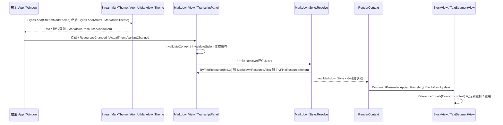

# 主题解析与下发（宿主资源 / `Md.*` → 不可变 `MarkdownStyle` → 每个块视图）

**Trigger:** 控件挂载到可视树（`OnAttachedToVisualTree`）、`ResourcesChanged`、`ActualThemeVariantChanged`（明暗切换），或宿主更换 `MarkdownServices` / `ImageBaseUri`  **Outcome:** 缓存被置空，下一帧由两个持有者之一重新执行 `MarkdownStyle.Resolve(控件)`，得到一份不可变快照并包成新的 `RenderContext`（实例身份即"变了"的信号）下发到每个块视图；没有 `Md.*` 覆盖时字体 / 字号沿用控件继承的 `TextElement` 值，行高是解析后字号的 1.6 倍。

## Steps
1. `src/StreamMark.Avalonia/Themes/StreamMarkTheme.axaml:1` — 默认主题是 `Styles` + `Styles.Resources` + `ThemeDictionaries`：Light（:9）/ Dark（:22）两个主题字典各 11 个 `SolidColorBrush`，主题字典之外 3 个不随明暗变化的键 `Md.MonospaceFontFamily`（:36）、`Md.BlockSpacing`（:37）、`Md.CornerRadius`（:38）；`Md.FontFamily` / `Md.FontSize` / `Md.LineHeight` 故意不设（注释 :4-5）。代码侧以 `x:Class` 编译加载（`Themes/StreamMarkTheme.axaml.cs:11`）(`theme-and-styles`)
2. `README.md:27` — 宿主注册顺序：`Styles.Add(new StreamMarkTheme());` 在前，宿主主题（如 `AtomUIMarkdownTheme`）**必须后加**（Avalonia 资源按后加入者优先）；仓库内示例见 `samples/StreamMark.Gallery/Program.cs:61`，无头测试宿主见 `tests/StreamMark.Avalonia.Tests/HeadlessApp.cs:20`(`theme-and-styles`)
3. `src/StreamMark.Theme.AtomUI/AtomUIMarkdownTheme.cs:AtomUIMarkdownTheme` — 构造函数里 13 次 `Map(key, SharedTokenKind.*)`（:19-31）；`Map`（:34）写的是 `Resources[key] = new MarkdownResourceAlias(token)`，**只登记别名、不解析 token**。`MarkdownResourceAlias` 本身只是 `sealed record(object Key)`（`MarkdownResourceAlias.cs:8`），注释说明它"从 Markdown 控件本身开始查找"(`theme-and-styles`)
4. `src/StreamMark.Avalonia/MarkdownView.cs:MarkdownView`（构造函数 :48）— 挂 `ResourcesChanged += (_, _) => InvalidateContext()`（:64）与 `ActualThemeVariantChanged += (_, _) => InvalidateContext()`（:65）；`MarkdownServices.ServicesProperty` / `ImageBaseUriProperty` 变化的类处理器同样走它（:44、:45）(`avalonia-text-rendering`)
5. `src/StreamMark.Avalonia/MarkdownView.cs:OnAttachedToVisualTree`（:178）— 只做 `Subscribe()`、`_context = null`（:186）、`RequestFrame()`；即"挂载即重解析"。`OnSourceChanged`（:113）与 `OnDetachedFromVisualTree` 只改订阅，不改样式(`avalonia-text-rendering`)
6. `src/StreamMark.Avalonia/MarkdownView.cs:InvalidateContext`（:172）— 全部动作只有 `_context = null; RequestFrame();`：**置空缓存**，不直接触碰任何已有块视图(`avalonia-text-rendering`)
7. `src/StreamMark.Avalonia/MarkdownView.cs:RequestFrame`（:140）— `_frameRequested` 合帧（:142），`TopLevel.GetTopLevel(this)` 为 null 直接放弃（:146-149），否则 `top.RequestAnimationFrame`（:151）→ 回调 `ApplyLatest`（:154）
8. `src/StreamMark.Avalonia/MarkdownView.cs:ApplyLatest`（:159）— `_context ??= CreateContext()`（:165），随后 `_presenter.Apply(document.Latest, _context)`（:166）；`CreateContext`（:169）是唯一的解析点：`new(MarkdownStyle.Resolve(this), MarkdownServices.GetServices(this), Selection, 0, Stream?.State, _state, MarkdownServices.GetImageBaseUri(this))`（:170）(`theme-and-styles`)
9. `src/StreamMark.Avalonia/Rendering/MarkdownStyle.cs:MarkdownStyle.Resolve`（:66）— 取 `control.ActualThemeVariant` 与 `isDark`（:68-69），定义局部 `Get<T>(string key, T fallback)`（:70）；每个键先 `control.TryFindResource(key, variant, out var value)`（:72），未命中就 `return fallback`（:74）(`theme-and-styles`)
10. `src/StreamMark.Avalonia/Rendering/MarkdownStyle.cs:MarkdownStyle.Resolve` 内的别名循环（:77）— `for (var depth = 0; value is MarkdownResourceAlias alias && depth < 4; depth++)`，每层都 `control.TryFindResource(alias.Key, variant, out value)`（:79）：**必须从控件本身再查一次**，因为 AtomUI 的 token 注册在窗口 / 主题作用域，而 `Md.*` 字典在自己的位置向上查找看不到它们（`docs/decisions.md:27`）；目标未命中 `return fallback`（:81）(`theme-and-styles`)
11. `src/StreamMark.Avalonia/Rendering/MarkdownStyle.cs:MarkdownStyle.Resolve` 内的类型判定（:84-92）— `value is T typed` 直接返回（:84-87）；`value is Color color && typeof(T) == typeof(IBrush)` 时转 `new ImmutableSolidColorBrush(color)`（:88-90）；其余一律 `return fallback`（:92）(`theme-and-styles`)
12. `src/StreamMark.Avalonia/Rendering/MarkdownStyle.cs:MarkdownStyle.Resolve` 内的一次性读取（:95-123）— 先解析 `foreground`（:95）与 `secondary`（:96），再用它们当默认值：`InlineCodeForeground` = `foreground`（:104）、`ListMarkerForeground` = `secondary`（:105）；字体 / 字号缺省时取控件继承值 `control.GetValue(TextElement.FontSizeProperty)`（:98）与 `TextElement.FontFamilyProperty`（:99）；等宽字体回退 `"Menlo, Consolas, monospace"`（:117）；**`LineHeight` 用的是解析后的 `fontSize`**：`Get<double>(Md.LineHeight, Math.Round(fontSize * 1.6))`（:119）；`BlockSpacing` 缺省 12（:120）、`CornerRadius` 缺省 `new CornerRadius(6)`（:121）、`IsDark = isDark`（:122）(`theme-and-styles`)
13. `src/StreamMark.Avalonia/Rendering/MarkdownStyle.cs:MarkdownStyle`（:15）— 对象是**不可变快照**：21 个 `required … { get; init; }` 属性（:17-37），`CodeFontSize` / `CodeLineHeight` / `HighlightTheme` / `HeadingFontSize` / `AlertBrush` 都是现算（:39、:41、:43、:46、:56），没有 setter，所以"改样式"只能靠重建实例(`theme-and-styles`)
14. `src/StreamMark.Avalonia/Rendering/RenderContext.cs:RenderContext`（:14）— 快照被装进上下文：`Style = style`（:18），`Style` 为只读属性（:25）；`With(...)`（:52）与 `WithHtml(...)`（:60）每次都 `new` 一个实例并沿用同一个 `Style` 引用。因此**上下文实例身份就是"样式变了没"的唯一信号**（类注释 :9-10）(`theme-and-styles`, `avalonia-text-rendering`)
15. `src/StreamMark.Avalonia/Rendering/DocumentPresenter.cs:DocumentPresenter.Apply`（:30）— `var contextChanged = !ReferenceEquals(Context, context)`（:32）；差异回放里 `Insert` 走 `BlockViewFactory.Create` + `view.Update`（:41-43），`Update` 先问 `BlockViewFactory.CanReuse`（:51）(`avalonia-text-rendering`, `avalonia-plugin-system`)
16. `src/StreamMark.Avalonia/Rendering/DocumentPresenter.cs:Restyle`（:83）— `contextChanged` 为真时按原模型全量重应用所有视图（:73-76），视图类型可能因此替换（新上下文下 `ViewTypeFor` 的结果会变，例如 `BlockViewFactory.cs:95` 只在代码块闭合且存在图表渲染器时给 `ViewType.Diagram`）(`avalonia-text-rendering`)
17. `src/StreamMark.Avalonia/Rendering/BlockView.cs:BlockView.Update`（:25）— 每个块视图自己再判一次 `contextChanged = !ReferenceEquals(Context, context)`（:27）并把结果传进 `OnUpdate(...)`（:32）；容器视图 `StackBlockView.UpdateChildren`（:75）按位置 `CanReuse` 复用子视图或替换（`BlockViewFactory.CanReuse`，`BlockViewFactory.cs:40`）(`avalonia-text-rendering`)
18. 解析结果只被两处持有（无跨进程 / 跨线程边界，全流程都在界面线程上）：`MarkdownView._context`（`MarkdownView.cs:34`，赋值点 `:165`）与 `TranscriptPanel._style`（`TranscriptPanel.cs:66`，赋值点 `:232`、`:392`、`:717`）。全仓库 `MarkdownStyle.Resolve` 的调用点只有 `MarkdownView.cs:170`、`TranscriptPanel.cs:232`、`:392`、`:717` 与两个测试（`tests/StreamMark.Avalonia.Tests/Rendering/StyleKeysTests.cs:20`、`:34`）(`theme-and-styles`, `avalonia-transcript`)
19. `src/StreamMark.Avalonia/Rendering/TextSegmentView.cs:TextSegmentView.Set`（:102）— 变化判定包含 `!ReferenceEquals(_context, context)`（:139）；`appendOnly` 只在上下文引用未变时才允许走增量路径（:162），差异点 `FirstDifference`（:163）→ `_runCache.InvalidateFrom(段落起点)`（:174-175）；上下文变了必然 `from = 0` + `_runCache.Invalidate()`（:166-168）→ 全文重排(`avalonia-text-rendering`)
20. `src/StreamMark.Avalonia/Rendering/TextSegmentView.cs:TextSegmentView.EnsureLayout`（:288）— 行高按字号比例取快照值：`lineHeight: _context.Style.LineHeight * (_fontSize / _context.Style.FontSize)`（:311）；`Style.Foreground` 是默认前景（:309）；HTML 盒子里的绝对字号按 `context.Style.FontSize` 缩放（:125）。所以宿主改窗口字号会连带改行高(`avalonia-text-rendering`)
21. `src/StreamMark.Avalonia/Transcript/TranscriptPanel.cs:TranscriptPanel`（构造函数 :82）— 同样挂 `ResourcesChanged`（:90）与 `ActualThemeVariantChanged`（:91）→ `InvalidateStyle`；静态构造函数挂 `MarkdownServices.ServicesProperty`（:96）；`OnAttachedToVisualTree` 也调它（:830）(`avalonia-transcript`)
22. `src/StreamMark.Avalonia/Transcript/TranscriptPanel.cs:InvalidateStyle`（:219）— `_style = null`（:221）并对**每个 entry** `entry.Context = null`（:222-225），然后 `RequestFrame()` + `InvalidateMeasure()`；序号变化时也逐条置空（`SyncEntries`，:191-197）(`avalonia-transcript`)
23. `src/StreamMark.Avalonia/Transcript/TranscriptPanel.cs:ContextFor`（:230）— `_style ??= MarkdownStyle.Resolve(this)`（:232，**解析对象是面板自己**），Services 每次现取（:233），任一身份不等（`state.Context is null || !ReferenceEquals(state.Context.Style, _style) || !ReferenceEquals(state.Context.Services, _services) || ImageBaseUri 不等`，:234-235）就重建该条目的 `RenderContext`（:238）(`avalonia-transcript`)
24. `src/StreamMark.Avalonia/Transcript/TranscriptPanel.cs:MeasureOverride`（:703）— 排版兜底路径也解析一次：`_style ??= MarkdownStyle.Resolve(this)`（:717），未测量行的高度估算同样用快照（`Estimate`，:560-580；`EstimateText`，:390-412，`charsPerLine = width / (style.FontSize * 0.62)`），行间距用 `_style?.BlockSpacing ?? 12`（`EnsureTops`，:617）(`avalonia-transcript`)
25. `src/StreamMark.Avalonia/Transcript/TranscriptPanel.cs:ApplyAll`（:250）— 每次 `ApplyLatest` 逐条目 `ContextFor(i, state)`（:259）；快照没变但上下文变了时走 `RefreshRealizedContexts`（:482）：逐行 `ViewContext(view)`（= `view.CurrentContext`，:493）与当前上下文比引用，不等则 `UpdateView`（:526）；新实例化的行在 `Realize`（:652）里 `ContextFor` + `BlockView.Update`（:666-670）(`avalonia-transcript`)
26. `src/StreamMark.Avalonia/Rendering/CodeBlockState.cs:CodeBlockState.For`（:48）— 快照的明暗经 `context.Style.HighlightTheme`（:51，`MarkdownStyle.cs:43` 的 `IsDark ? Dark : Light`）进入高亮状态；语言 / 高亮器 / 主题任一变化就 `Dispose` 旧状态并重建（:53-58），新主题在 `CreateSession(Language, Theme)`（:104）上生效。⇢ 同样进入 TextMate 主题：`src/StreamMark.Highlighting.TextMate/TextMateSyntaxHighlighter.cs:TextMateSyntaxHighlighter.GetContext`（:148）按 `HighlightThemeKind` 选 `ThemeContext`（`ThemeContext.cs:31-41` 从 TextMate 主题里取 `editor.foreground` / `editor.background`）(`avalonia-plugin-system`, `theme-and-styles`)
27. `src/StreamMark.Avalonia/Rendering/DiffBlockView.cs:DiffHighlightState.For`（:790）— diff 视图把明暗以同样方式记进自己的高亮状态：`var theme = context.Style.HighlightTheme`（:793），与已有状态不一致就重建（:795-800）(`avalonia-text-rendering`)
28. `src/StreamMark.Avalonia/Rendering/DiagramBlockView.cs:DiagramBlockView.OnUpdate`（:56）— 明暗变化会改渲染 key：`var key = $"{code.Language}\n{style.IsDark}\n{code.Code}"`（:72），key 不同则 `StartRender`（:76）进而重建 `DiagramRenderContext(style.IsDark, ColorOf(style.Foreground), ColorOf(style.CodeBackground), ColorOf(style.LinkForeground), style.FontFamily.Name, style.FontSize)`（:103-104），该上下文被当作图表的"渲染上下文"传给后台渲染器（`Extensions/IDiagramRenderer.cs:7`、`:18`）；渲染结果按 (语言, 代码, 明暗) 缓存（类注释 :15，`DiagramCache.TryGet`，:86）(`avalonia-plugin-system`, `theme-and-styles`)
29. `src/StreamMark.Avalonia/Rendering/TextSegmentView.cs:InlineTextSource.GetTextRun`（:1090）— 行内组件绘制对象拿的是 `new Plugins.InlineComponentContext(style, _fontSize, _foreground, properties, _maxWidth)`，其中 `style` 就是快照；成对组件的样式覆盖也直接吃快照：`GetStyle(..., MarkdownStyle style)`（`Plugins/IMarkdownPlugin.cs:111`、`:124`，实现见 `Plugins/BuiltInComponentsPlugin.cs:246`）(`avalonia-plugin-system`)

## Sequence

## Errors and cancellation
- 键名写错或从未被任何字典定义：`control.TryFindResource(key, variant, out var value)` 返回 false → 直接 `return fallback`（`MarkdownStyle.cs:72-74`）。**不抛异常、不写日志**，表现为"宿主覆盖了但看起来没换肤"。
- 别名目标键找不到：同一处循环里 `return fallback`（`MarkdownStyle.cs:79-82`），效果与上一条相同。
- 别名链超过 4 层：`depth < 4` 使循环退出时 `value` 仍是 `MarkdownResourceAlias`，`value is T typed` 不成立 → `return fallback`（`MarkdownStyle.cs:77`、`:92`）。同样静默。
- 类型不符：例如目标值是 `string`、或值类型与取值处的 `T` 不一致（`CornerRadius` / `double` / `FontFamily` 都不走 `Color` 转换，只有 `Get<IBrush>` 时才转，`MarkdownStyle.cs:88`）→ `is T` 失败 → `fallback`（:84-92）。
- 没有取消令牌，也没有异常路径：一次 `ApplyLatest` 里 `Resolve` 只跑一次、纯同步读资源。帧请求靠 `_frameRequested` 合帧（`MarkdownView.cs:142`、`TranscriptPanel.cs:207`）；`TopLevel.GetTopLevel(this)` 为 null 时请求被丢弃（`MarkdownView.cs:146-149`），控件脱离可视树后的那次刷新会顺延到下次挂载时的置空 + 请求（`MarkdownView.cs:186`、`TranscriptPanel.cs:830`）——这一条只在代码上读到，未做运行验证 (unverified)。
- 宿主"改了资源但没生效"的常见原因：只有在触发 `ResourcesChanged` / `ActualThemeVariantChanged` 时才会置空重解析（`MarkdownView.cs:64-65`、`TranscriptPanel.cs:90-91`）；直接把资源写在 Markdown 控件所在作用域之外、又没有一次这两个事件，就不会重新解析。

## Where to hook in
- 新增一个 `Md.*` 键必须同步的位置（缺一处就有对应症状）：`MarkdownResourceKeys` 加常量（`MarkdownResourceKeys.cs:9-31`）→ `MarkdownStyle` 加 `required` 属性（`MarkdownStyle.cs:17-37`）并在 `Resolve` 的初始化器里 `Get<T>(键, 默认值)`（:100-123，漏了属性会直接编译失败）→ 在 `src/StreamMark.Avalonia/Rendering/**` 真的读它 → 默认值写进 `StreamMarkTheme.axaml` 的 Light（:9）/ Dark（:22）字典或主题字典之外（:36-38）→ 可选地在 `AtomUIMarkdownTheme.Map`（:19-31）指向 AtomUI token → 测试 `StyleKeysTests`（`tests/StreamMark.Avalonia.Tests/Rendering/StyleKeysTests.cs:12`）。
- 新增整套主题：继承 `Styles`，按 `Styles.Add(new StreamMarkTheme()); Styles.Add(new MyTheme());` 的顺序**后加**（`README.md:27-28`）；XAML 主题沿用 `x:Class` + `AvaloniaXamlLoader.Load`（`Themes/StreamMarkTheme.axaml.cs:11`）。
- 宿主换主题的推荐方式：换 `ThemeVariant`（走 `ActualThemeVariantChanged`）或替换原子级 `Md.*` 资源（走 `ResourcesChanged`）；像 AtomUI 这种"token 在窗口 / 主题作用域"的宿主不要写 `DynamicResource` 画刷，而应写 `MarkdownResourceAlias`（`docs/decisions.md:27`，实现见 `MarkdownStyle.cs:77`、`MarkdownResourceAlias.cs:4`）。
- 会破坏下发的改动：
  - 原地修改已有 `MarkdownStyle` 实例（属性全是 `get; init;`，`MarkdownStyle.cs:17`）或在视图里绕过快照直接查资源：身份不变则 `DocumentPresenter.cs:32`、`BlockView.cs:27`、`TextSegmentView.cs:139` 都不会重排重绘。
  - 给 `MarkdownStyle.Resolve` 的结果再加一层长生命周期缓存，或复用旧实例：`MarkdownView.cs:172` 与 `TranscriptPanel.cs:219` 依赖"置空 → 下一次新建"这条链。
  - 在 `InvalidateContext` / `InvalidateStyle` 里同步直接改块视图的属性：会绕过 `Restyle`（`DocumentPresenter.cs:83`）与 `BlockViewFactory.CanReuse`（`BlockViewFactory.cs:40`）的视图替换判定。
  - 改动 `RenderContext.With` / `WithHtml`（`RenderContext.cs:52`、`:60`）时丢掉 `Style` 引用透传：每个 HTML 盒子都会让文本片段上下文变化，触发整块重排。
  - 往宿主资源里写 `Color` 却把取值处的 `T` 取成非 `IBrush`：不会走 `MarkdownStyle.cs:88` 的转换，直接回落。
  - 给 `TranscriptPanel` 之外再加一个持有 `_style` 的地方（如静态缓存）：当前 `_style`（`TranscriptPanel.cs:66`）与 `MarkdownView._context`（`MarkdownView.cs:34`）是仅有的两个持有者，多一处就不会随 `InvalidateStyle` 一起失效。

## Related
- Modules: [theme-and-styles](../modules/theme-and-styles.md)
- Modules: [avalonia-text-rendering](../modules/avalonia-text-rendering.md)
- Modules: [avalonia-transcript](../modules/avalonia-transcript.md)
- Modules: [avalonia-plugin-system](../modules/avalonia-plugin-system.md)
- Flows: [streaming-token-to-view](streaming-token-to-view.md)
