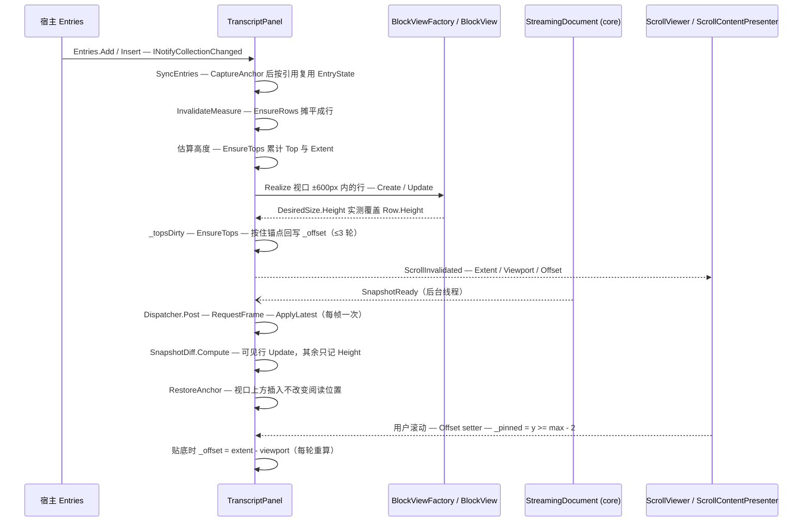

# 会话面板的虚拟化与滚动（行模型 → 视口窗口 → 锚定 → 贴底）

**Trigger:** 宿主向 `TranscriptView.Entries` 添加 / 插入 / 移除条目（宿主内容 `ContentEntry`、Markdown 消息 `MarkdownEntry`、延迟解析条目 `FromTextDeferred`），或某条消息的 `StreamingDocument` 产生新快照（`SnapshotReady`），或用户滚动 / 改变窗口宽度  **Outcome:** 只为视口 ±600px 内的行实例化 `BlockView`，其余行只以估算或上次实测的高度参与 `Extent`；追加与视口上方插入不改变用户当前阅读位置（视口内首行相对位置不变）；贴底时 `Offset` 恒等于 `extent - viewport` 并跟随最新内容，用户向上滚动即解除；被回收的行仍可被选中复制。

> 工作区状态：本页按 HEAD `cd7a2a8` 写；写作期间有并发改动落到工作树（`Rendering/DiffBlockView.cs`、`Extensions/CodeBlockOptions.cs`、`tests/.../DiffRenderingTests.cs`、`README.md`、`docs/decisions.md`），随后**被提交为 `a72b840`**（"Diff: GitHub Markdown style by default, header toggles split view"）。这批改动只动 diff 块的呈现（新增 `DiffViewMode.Markdown` 方式并把它设为默认，`Extensions/CodeBlockOptions.cs:31`；`DiffBlockView` 改为逐行 Markdown 风格），**没有触及本流程的任何一步** —— `git diff cd7a2a8 a72b840 --stat -- src/StreamMark.Avalonia/Transcript/` 为空，下面所有行号在 `cd7a2a8` 与 `a72b840` 上相同。但 `DiffBlockView` 是新的"高度依赖宽度"的块视图且没有对应的估算分支，"Where to hook in" 里记下了它的影响。

## Steps

1. `src/StreamMark.Avalonia/Transcript/TranscriptView.cs:TranscriptView` — 构造时 `Panel = new TranscriptPanel()`、`Panel.SetEntries(Entries)`、`Content = Panel`（:17-19），禁用横向滚动条、纵向 `Auto`（:20-21），`StyleKeyOverride` 沿用宿主主题里的 `ScrollViewer` 模板（:24），所以面板只是 `ScrollViewer.Content`（`avalonia-transcript`）
2. `src/StreamMark.Avalonia/Transcript/TranscriptPanel.cs:TranscriptPanel.SetEntries` — 把宿主集合按 `IReadOnlyList` 存下并退订 / 订阅 `INotifyCollectionChanged`（:134-147）；之后宿主的每次 `Add` / `Insert(0, …)` / `Remove` 都走 `OnCollectionChanged` → `SyncEntries`（:149）(`avalonia-transcript`)
3. `TranscriptPanel.SyncEntries` — **先** `CaptureAnchor()`（:154）**再**重建 `_entries`：用 `Dictionary<TranscriptEntry, EntryState>` 按**引用**复用旧状态（`existing.Remove(entry, out state)`，:155-172），新 `MarkdownEntry` 订阅 `Document.SnapshotReady`（:166-169），被移除的退订、`Unrealize` 它的所有行、移除内容控件（:173-187）；随后把 `Context = null` 的判定放在序号变化的条目上（:191-197，`RenderContext.Entry` 是选区坐标第一维）；末尾 `_rowsDirty = true` + `RequestFrame()` + `InvalidateMeasure()`（:198-200）(`avalonia-transcript`)
4. `TranscriptPanel.EnsureRows` — 摊平：对每个 `EntryState` 把 `state.Rows` 追加进 `_rows`（:588-605）。Markdown 消息的行不是在 `EnsureRows` 里建的，而是在 `ApplyAll` 里按 `SnapshotDiff` 的 `Insert` / `Update` / `Remove` 增删（:286-313），所以**每个 Markdown 顶层块至少一行**、`EntryState.Slots` 逐块记录占了几行（:295 / :310 / :444）；`ContentEntry` 恒一行、初始高度固定 60（:592-598）；未解析的延迟条目是一行占位行（`Row.Block == null`，高度 `EstimateText(DeferredText)`，:599-603）(`avalonia-transcript`)
5. `TranscriptPanel.ChunkCount` — 超长代码块分段：行数 `> ChunkThresholdLines = 200` 时按 `LinesPerChunk = 128` 拆成 `(lines + 127) / 128` 行（:496-516，`ChunkCountLines` 在 :557 数换行符）；折叠的代码块（`CodeBlockView.ShouldCollapse`）不分段（:502-505）；`Realize` / `UpdateView` 时经 `ApplyChunk` 调 `CodeBlockView.SetChunk(chunk, count, 128)`，让该段只排版自己的行窗口（:518-524）(`avalonia-transcript`、`avalonia-text-rendering`)
6. `TranscriptPanel.Estimate`（两个重载）+ `EstimateText` — 估算只对"从未进过视口"的行存在：按块类型给初始高度（`ParagraphBlock` = 行数 × `LineHeight`、`CodeBlock` = 行数 × `CodeLineHeight` + 48、`ThematicBreakBlock` = 17、`_` = `LineHeight × 2`，:560-580），每行字符数按 `width / (FontSize × 0.62)` 估（:564），`_width` 还是 `NaN` 时兜底 **720**（:563，`_width` 初值见 :68）；分段行单独走 `Estimate(Row, …)`，把代码块头部 34 / 底部 14 加到首段与末段（:547-555）；延迟条目的占位行按换行与空行累加（`EstimateText`，含 `BlockSpacing` 合并连续空行，:390-412）(`avalonia-transcript`、`avalonia-text-rendering`)
7. `TranscriptPanel.EnsureTops` — 自顶向下累加 `Row.Top` 与总高度：同一块的分段相接（间距 0）、同一消息的块之间 `BlockSpacing`、跨消息 `EntrySpacing`（默认 24，:113），算完写 `_extent = (宽度, y)` 并清 `_topsDirty`（:610-631）；样式未解析时间距兜底 12（:617）；`_style` 解析自 `MarkdownStyle.Resolve`（:717，默认 `BlockSpacing = 12`、`LineHeight = round(fontSize × 1.6)`，`Rendering/MarkdownStyle.cs:119-120`）——任何 `_topsDirty` 都是 O(行数) 全量重算（`avalonia-transcript`、`avalonia-text-rendering`）
8. `TranscriptPanel.MeasureOverride` — 一次测量内按序串起整条链：宽度变化检查（:708-716）→ `EnsureRows()` → `EnsureTops()` → `RestoreAnchor()` → `ParseVisibleDeferred(height)`（:718-721）→ 记下"视口内首行 + 相对视口位置"（:723-726）→ 3 轮实例化 / 测量循环（:728-775）→ 夹 `Offset`、写 `_viewport` / `_extent`、`UpdateTail`、触发 `ScrollInvalidated`（:777-783）(`avalonia-transcript`)
9. `TranscriptPanel.ParseVisibleDeferred` — 在视口窗内（贴底时用 `max(0, _extent.Height - height)` 当作 `offset`，:365）扫到 `Row.Block == null` 且 `Owner.Entry is MarkdownEntry { IsParsed: false }` 的行就 `CaptureAnchor()` + `EnsureParsed()`（:369-377），然后 `ApplyAll` + `EnsureRows` + `EnsureTops` + `RestoreAnchor`，最多 **8 轮**（:363 / :382-385）；`EnsureParsed` 用 `Interlocked.Exchange` 保证只解析一次（`TranscriptEntry.cs:48-54`），解析走界面线程同步的 `StreamingDocument.LoadNow`（`StreamingDocument.cs:126`）(`avalonia-transcript`、`core-streaming`)
10. ⇢ crosses **thread** boundary via `StreamingDocument.SnapshotReady`（`Action<DocumentSnapshot>`，在**后台线程**触发，契约要求处理函数尽快返回）(`core-streaming`；`StreamingDocument.cs:49-50`、发布点 `:230-231`)
11. `TranscriptPanel.OnSnapshotReady` → `RequestFrame` → `TopLevel.RequestAnimationFrame` — 事件处理只做 `Dispatcher.UIThread.Post(RequestFrame, DispatcherPriority.Render)`（:203）；`RequestFrame` 用 `_frameRequested` 合帧，每帧最多一次，帧回调里调 `ApplyLatest()`（:205-217）(`avalonia-transcript`)
12. `TranscriptPanel.ApplyAll` — 遍历所有条目，未解析 / 非 Markdown 条目直接跳过（:255）；占位行刚解析完时先 `CaptureAnchor()` 清空该条目的行与 `Slots`、把 `Applied` 置回 null 以触发全量重建（:261-269）；`state.Applied` 与 `latest` 同一对象且视图块未变时走 `RefreshRealizedContexts` 快路径（:270-275）；否则 `CaptureAnchor()` + `foreach (var op in SnapshotDiff.Compute(state.Applied, latest))` 按 `op.Index` 前累加 `Slots` 得到 `rowStart`（:276-284）(`avalonia-transcript`、`core-streaming`)
13. `src/StreamMark.Core/Streaming/SnapshotDiff.cs:SnapshotDiff.Compute` — 差异语义：同代且共享冻结列表时从 `min(previous.FrozenCount, next.FrozenCount)` 起比（:28），按 `Key`（= 块源码起点）归并，同 key 且类型 / `Range` / `ComputeFingerprint()` 有变化才发 `Update`（:35-45）；`DiffOp.Index` 是"正在变换的列表"中的位置（:12-15）(`core-streaming`、`core-parsing-and-model`)
14. `TranscriptPanel.ApplyAll` 的三支 — `Insert`：按 `ChunkCount` 建 `count` 个 `Row`（高度取 `Estimate`）、插入 `op.Index` 对应的行位并写 `Slots`（:286-298）；`Update` → `UpdateBlockRows`（:299-300）；`Remove`：先 `Unrealize` 再删掉该块占的所有行（:302-313）；三支都会置 `_rowsDirty` / `_topsDirty`（:296 / :311 / :447 / :449）(`avalonia-transcript`)
15. `TranscriptPanel.UpdateBlockRows` / `UpdateView` — **差异只更新可见行，可见行之外只记账**：只有 `updated.View is BlockView`（即当前已实例化）的行才 `view.Update(context, …)`，其余行只重算 `updated.Height = Estimate(updated, context)`（:428-443）；`UpdateView` 用 `BlockViewFactory.CanReuse` 决定原地更新还是替换视图（:526-545，`Rendering/BlockViewFactory.cs:40`）；块状态（代码块展开 / 折叠、换行、diff 显示方式）随 `EntryState.State`（`Plugins/BlockStateStore`）跨行增删与视图回收存活（`TranscriptPanel.cs:39`）(`avalonia-transcript`、`avalonia-text-rendering`)
16. `TranscriptPanel.MeasureOverride` 的实例化窗口 — `Overscan = 600`（:55）；每轮按 `top = max(0, offset - 600)`、`bottom = offset + height + 600` 取行区间（`FirstRowAt` 二分，:633-650 / :734-738），对区间内每行 `Realize` 后 `view.Measure(new Size(contentWidth, ∞))`，再把 `view.DesiredSize.Height` 与 `row.Height` 比较，差 > 0.5 就改写（:745-759）；`_realized` 里本轮没被保留的行 `Unrealize`（:761-764）；只要高度有变化就 `_topsDirty = true` + `EnsureTops()`，并（非贴底且锚点还在）保持视口首行位置（:765-775），最多 **3 轮**（:728）(`avalonia-transcript`、`avalonia-text-rendering`)
17. `TranscriptPanel.Realize` / `Unrealize` / `BuildContent` — 实例化：`ContentEntry` 用缓存的内容控件或 `FindDataTemplate` / `TextBlock` 兜底（:660-663 / :679-689），Markdown 行走 `BlockViewFactory.Create` + `Update` + `ApplyChunk` 并 `Children.Add`，行加入 `_realized`（:664-676）；回收：`Children.Remove` 后块视图直接丢弃（`row.View = null`），宿主内容控件留在 `EntryState.ContentView` 以便再次出现时复用（保住其内部状态）（:691-701）；排列按 `row.Top - _offset.Y` 定位、内容列按 `MaxContentWidth` 居中（:786-795）(`avalonia-transcript`、`avalonia-text-rendering`)
18. `TranscriptPanel.Extent` / `Viewport` / `Offset`（`ILogicalScrollable`）— 面板自算的滚动几何：`Extent` / `Viewport` 在测量末尾写入（`_viewport = (fullWidth, height)`、`_extent` 宽度取完整可用宽度、高度不变，:779-780），`ScrollSize = (0, 48)`（每行 48px 的键盘 / 滚轮步长）、`PageScrollSize = (0, max(48, viewport.Height - 48))`（:848-850）；测量末尾与 `SetOffsetInternal` 后各触发一次 `ScrollInvalidated`（:782 / :919）(`avalonia-transcript`)
19. `Avalonia.Controls.Presenters.ScrollContentPresenter`（12.1.3，非本仓库代码）— `TranscriptView` 的模板把本面板当 `Child`，presenter 订阅 `ScrollInvalidated` 并在回调里 `Viewport = scrollable.Viewport; Extent = scrollable.Extent; SetCurrentValue(OffsetProperty, scrollable.Offset)`，反向把 `ScrollViewer.Offset` 的变化写回 `scrollable.Offset`（Avalonia 12.1.3 `ScrollContentPresenter.UpdateScrollableSubscription` / `UpdateFromScrollable`，随包版本走，本仓库未固定源码路径：(unverified))；这就是"用户滚轮 / 拖动滚动条 → 面板 `Offset` setter"的通道（`avalonia-transcript`）
20. `TranscriptPanel.CaptureAnchor` / `RestoreAnchor` / `PendingAnchor` — 视口上方插入的锚定：`CaptureAnchor` 在 `_pendingAnchor` 已有值、**贴底**或 `_rows` 为空时提前返回（:321-326，所以贴底期间不记锚点），否则 `EnsureTops` 后取 `FirstRowAt(_offset.Y)` 的行，记下 `(行, 行顶 - offset, 所属条目顶 - offset)`（`PendingAnchor` 记录，:333-335 / :80）；恢复时若该行还在原条目里就 `_offset = 行顶 - delta`（:349-352），若该行已被替换（延迟条目占位行展开成真实行）就改用**条目顶部**（:353-357），贴底或条目已被移出 `_entries` 则丢弃（:345-347）；用户直接改 `Offset` 或经 `SetOffsetInternal` 时清空 `_pendingAnchor`（:873 / :914）(`avalonia-transcript`)
21. `TranscriptPanel.CaptureAnchor` 的调用点 + 测量末尾的锚点回写 — `SyncEntries`（:154）、`ApplyAll`（:264 / :276）、`ParseVisibleDeferred`（:373）、代码块展开 / 折叠（:470）都会在改动行结构**之前**记锚点；测量循环里 `anchor` 是"本轮开始时的视口首行 + delta"，高度变化后回写 `_offset = anchor.Top - anchorDelta`（:723-726 / :771-774）；两处回写都只改 `_offset` 而不改 `_pinned`，所以贴底期间由 :730-733 的分支接管（`TranscriptPanel.CaptureAnchor` / `RestoreAnchor`）(`avalonia-transcript`)
22. `TranscriptPanel.MeasureOverride` 的贴底分支 — 贴底时**每一轮**都把 `_offset` 直接置为 `max(0, _extent.Height - height)`（:730-733），所以新内容（或实测行高变大）到达时视口自动跟到底部；`_pinned` 初值 `true`（:72，新面板一开始就贴底），`ScrollToEnd()` 只置位 + `InvalidateMeasure()`（:834-838）(`avalonia-transcript`)
23. `TranscriptPanel.Offset` setter — 用户滚动的反馈：把 `y` 夹到 `[0, max(0, extent.Height - viewport.Height)]`（:865-866），与当前值差 `< 0.01` 直接返回（:867-870），否则写 `_offset`、**`_pinned = y >= max - 2`**（滚离底部即解除贴底、滚回底部 2px 内自动恢复）、`_pendingAnchor = null`、`InvalidateMeasure()`（:871-875）；`_settingOffset` 期间忽略回写以防 `ScrollInvalidated` 递归（:861-864 / :909-925）；`BringIntoView` 只在**已实例化**的行里找目标控件并滚动，未命中返回 false（:880-903），`GetControlInDirection` 恒 `null`（无键盘逐行导航，:905）(`avalonia-transcript`)
24. `TranscriptPanel.MeasureOverride` 的宽度变化处理 — `width`（= `min(可用宽度, MaxContentWidth)`，:705-706）与 `_width` 不等时把**所有** `Row.Measured` 置 false 并 `_topsDirty = true`（:708-716）——行高作废但不立即重算，只有行再次进入 ±600 窗口时才重新测量，所以宽度变化后 `Extent` 是逐步收敛的；`MaxContentWidth` 只影响内容列宽度与排列的居中 `x`（:786-789），`Extent.Width` 始终是完整可用宽度（:780）(`avalonia-transcript`、`avalonia-text-rendering`)
25. ⇢ crosses **thread** boundary (I/O → UI) via `ImageSlot.Load` 的 `Dispatcher.UIThread.InvokeAsync` — 视口内某行的图片加载完成后 `TextSegmentView.OnResourceLoaded`（`Rendering/TextSegmentView.cs:371-378`）→ `InvalidateLayout`（:224-231）→ 下一轮 `MeasureOverride` 把新的 `DesiredSize.Height` 写进 `Row.Height` 并 `EnsureTops`，该行与后续行位置随之修正（`ImageSlot.cs:80-98` 回投、`TranscriptPanel.cs:754-758` 实测）(`avalonia-images`、`avalonia-text-rendering`)
26. `TranscriptPanel`（`ISelectionHost`）— **被回收到内存之外的行仍可复制**：`RealizedSegments()` 只枚举 `_rows` 中已实例化的 `BlockView`（命中测试用，:931-932），但 `GetSnapshot(entry)` 返回与视图无关的 `state.Applied`（:938-953），`GetSource` 从 `StreamingDocument.GetText` 取源码（:955-956）；跨到尚未解析的条目时 `EnsureParsed()` + `RequestFrame()` 后返回刚同步产出的 `Document.Latest`（:945-951）；`SelectionController.GetSelectedText` 因此遍历快照的 `Blocks` 拼文本（`Selection/SelectionController.cs:187-227`），完全基于模型、与行是否实例化无关（`avalonia-selection`、`core-streaming`）
27. `TranscriptPanel.UpdateTail` — 每轮测量末尾只把"最后一个带 `State` 的 `MarkdownEntry` 的最后一行"的 `LastSegment()` 标为 `IsDocumentTail`（:798-825），流式光标与渐显只在那里渲染（`Rendering/TextSegmentView.cs:458-478`）；上一轮的尾段被清 `IsDocumentTail` 并 `InvalidateVisual`（:814-818）(`avalonia-text-rendering`)

## Sequence

## Errors and cancellation
- **估算误差表现为跳变，陈旧行高表现为重叠。** 估算只影响从未进过视口的行；一旦该行进入 ±600px 就被 `DesiredSize.Height` 改写，`_topsDirty` → `EnsureTops` 全量重算 `Top` 与 `Extent`，滚动条拇指长度随之变化（用户看到"滚过一段后滚动条跳一下"）。因此这里的比较**总是**拿当前 `DesiredSize.Height` 与 `row.Height` 比，而不是只在 `!row.Measured` 时测（`TranscriptPanel.cs:747-759`，注释在 :752-753）——因为宿主内容控件自行展开 / 折叠时布局管理器会先单独重测它，此时 `view.IsMeasureValid` 与 `row.Measured` 都为真但记录已过期。回归测试：`tests/StreamMark.Avalonia.Tests/Transcript/TranscriptViewTests.cs:142`（展开后两行不重叠）。
- **测量循环有 3 轮上限**（`TranscriptPanel.cs:728`）。图片 / 公式异步就绪、锚点回写又改变实测高度这类"持续变化"的情形，本轮会以一个尚未自洽的 `Offset` 结束，下一次布局（`InvalidateMeasure`）再收敛 —— 表现是一两帧内的轻微位移，而不是死循环。
- **延迟条目未解析。** `ParseVisibleDeferred` 最多 8 轮（`TranscriptPanel.cs:363`）；超过上限仍未解析的占位行在实例化循环里被显式跳过（`row.Block is null && row.Owner.Entry is MarkdownEntry`，:741-744），继续以 `EstimateText` 的高度参与滚动，界面上是"看起来存在但空白的一行"。`LoadNow` 要求文档无挂起工作，否则抛 `InvalidOperationException`（`StreamingDocument.cs:130-133`），该异常会沿 `EnsureParsed` → `ParseVisibleDeferred` → `MeasureOverride` 直接冒到布局（延迟条目通常刚创建、无挂起工作，所以正常路径不触发）。
- **`BringIntoView` 未命中返回 false。** 只在 `_realized` 中按 `ReferenceEquals(view, target) || view.IsVisualAncestorOf(target)` 查找（`TranscriptPanel.cs:880-903`）；目标行被回收（或从未实例化）时找不到，不会被"先实例化再滚过去"，宿主需要自己先把 `Offset` 移到目标附近再重试。`GetControlInDirection` 恒 `null`（:905），所以没有键盘逐行导航。
- **回收会让流式光标 / 渐显消失。** `UpdateTail` 取的是 `state.Rows[^1].View as BlockView` 的 `LastSegment()`（`TranscriptPanel.cs:806`）；该尾行被回收时 `row.View == null`，`_tail` 变成 null，旧尾段被清 `IsDocumentTail`（:814-818）——用户上滚超过 600px 后正在流式的那段就不再画光标。
- **条目对象复用是"按引用"的。** 同一个 `TranscriptEntry` 从 `Entries` 移除再放回会新建 `EntryState`（`SyncEntries` 的 `existing` 里已经没有了，:155-172），行、`Applied`、块状态（代码块展开 / 折叠 / 换行、diff 显示方式）全部丢失；顺序变化也会丢弃 `RenderContext`（:191-197），下一帧重建（`ContextFor`，:230-241）。
- **锚点会主动放弃。** `CaptureAnchor` 在贴底、`_pendingAnchor` 已有值、`_rows` 为空时不记（:321-326）；`RestoreAnchor` 在贴底或锚点条目已不在 `_entries` 中时丢弃（:345-347）；用户任何直接 `Offset` 写入（含 `SetOffsetInternal`）都会清 `_pendingAnchor`（:873 / :914）。所以"贴底时期待内容不动"不成立——贴底由 `_offset = extent - height` 重新钉住。
- **删除行 / 移除条目都会立刻回收视图**：`DiffKind.Remove` 逐行 `Unrealize` 再 `RemoveAt`（:302-313），`SyncEntries` 对消失的条目 `Unrealize` 全部行并移除内容控件（:173-187）。被回收的 `BlockView` 上的临时界面状态（`CodeTextView` 的横向偏移、`ImageSlot` 的租约）随之丢弃；块级状态因存在 `EntryState.State` 而保留（`Plugins/BlockStateStore.cs`，`RenderContext.State`）。
- **解析失败在 core 侧被吞掉**（`StreamingDocument.Run` 的 `catch (Exception ex) { Debug.WriteLine; snapshot = null; }`，`StreamingDocument.cs:222-227`），面板收不到新快照：表现是"界面停在旧内容"，但行模型、`Extent`、锚定与贴底仍按旧内容正常工作。
- **无取消机制。** `TranscriptPanel` / `StreamingDocument` 都不接受 `CancellationToken`；正在进行的测量 / 差异应用没有中断点，只能等它跑完（全量 `EnsureTops` 是 O(行数)）。

## Where to hook in
- **新增宿主条目类型**（工具调用卡片、推理折叠块等）：`TranscriptEntry.cs` 加子类（照 `ContentEntry`，`TranscriptEntry.cs:68`）→ `EnsureRows` 给初始高度（现有分支只认 `ContentEntry` 与未解析 `MarkdownEntry`，`TranscriptPanel.cs:592-603`）→ `Realize` 构建控件（:652-677）→ `Unrealize` 决定是否像 `EntryState.ContentView` 那样缓存控件以保住内部状态（:691-701）。自带文档的条目还要在 `SyncEntries` 订阅 / 退订 `SnapshotReady`（:165-177），并在 `ApplyAll` 里跳过非文档条目（:255）。漏掉 `EnsureRows` 的表现是：条目进了 `_entries` 但 `state.Rows.Count == 0`，`_rows` 里没有它（:604），界面不显示、`RowCount` 也不含它。
- **新增影响行高的块类型**：① `Estimate(MarkdownBlock, RenderContext)` 的 switch（`TranscriptPanel.cs:560-580`）；② 估算侧的魔数与视图常量重复：`Estimate(MarkdownBlock, …)` 里 `CodeBlock` 的 `+48`（`TranscriptPanel.cs:570`）就是 `CodeBlockView` 的 `HeaderHeight = 34` 加底部间距 `Padding = 14`，而分段估算 `Estimate(Row, …)` 把 **34 / 14** 拆开按首段 / 末段加（`TranscriptPanel.cs:552`，常量定义 `CodeBlockView.cs:24-25`）——三处是同一组常量的重复；③ 插件围栏视图（`BlockViewFactory` 的 `FindFenceView` 分支，`Rendering/BlockViewFactory.cs:15`）**没有**对应的估算分支，会落到 `CodeBlock` 的"+48"或 `_ => LineHeight × 2`，`DiffBlockView`（`Rendering/DiffBlockView.cs`，`a72b840` 起是 `diff` / `patch` 围栏的默认呈现；`HeaderHeight = 34` + 底部 6，:42 / :166；按宽度重建行，:614-617）就是这种情况：估算偏差只能靠实测纠正。
- **新增要分段的块类型**：同时改 `ChunkCount`（:500-516，目前只认 `CodeBlock`，且折叠时不分段）与 `ApplyChunk`（:518-524，目前只 `SetChunk` 到 `CodeBlockView`）；漏掉 `ApplyChunk` 的表现是每段都渲染整块。
- **新增 `DiffKind`**：`src/StreamMark.Core/Streaming/SnapshotDiff.cs:5` 的枚举有**两份** switch 消费这套语义 —— `Rendering/DocumentPresenter.cs`（单条消息视图）与 `TranscriptPanel.ApplyAll`（:284-314），必须同步。
- **估算与视图重复的常量清单**（改一处要连着看）：`Overscan = 600`（:55）、`ScrollSize = (0, 48)`（:848）、兜底宽度 `720`（`EstimateText` :393、`Estimate` :563、`MeasureOverride` :705）、字宽系数 `0.62`（:394 / :564）、高度容差 `0.5`（:755）、贴底容差 `2`（:872 / :913）、测量轮数 `3`（:728）、延迟解析轮数 `8`（:363）、`ContentEntry` 初始高度 `60`（:596）、`ChunkThresholdLines = 200` / `LinesPerChunk = 128`（:496 / :498）、`Estimate` 里的 `48`（:570）、`ThematicBreakBlock = 17`（:577）、空行按 `BlockSpacing` 计一次（:403）。
- **会破坏锚定的改动**：在 `SyncEntries` / `ApplyAll` / `UpdateBlockRows` / `OnCodeExpandedChanged` 之外改 `_rows` 或 `Row.Height` 而不置 `_topsDirty`（`Top` 会与高度脱节，滚动条与命中错位）；直接写 `_offset` 而不清 `_pendingAnchor`（陈旧锚点在下一轮测量里把视口拉回旧位置）；把 `CaptureAnchor` 挪到行结构变化之后；放宽 / 收紧 `Offset` setter 里的 `max - 2` 判定（:872）会改变"贴底自动恢复"的手感；在 `MeasureOverride` 之外触发 `ScrollInvalidated` 而不设 `_settingOffset`（:909-925）会递归回写。
- **测试位置**：`tests/StreamMark.Avalonia.Tests/Transcript/` —— `TranscriptViewTests.cs`（贴底 / 流式 / 跨消息选区 / 宿主内容增高）、`VirtualizationScaleTests.cs`（10 万块 + 追加）、`DeferredEntryTests.cs`（延迟解析、视口上方插入保持不动）、`LongCodeTests.cs`（3000 行分 24 段、跨段复制、跳转耗时中位数 + 宽松最大值）。都跑在 `HeadlessApp.Run`（界面线程）+ `HeadlessApp.Settle()` 帧步进里（`tests/StreamMark.Avalonia.Tests/HeadlessApp.cs:55/65`）。

## Related
- Modules: [avalonia-transcript](../modules/avalonia-transcript.md)
- Modules: [core-streaming](../modules/core-streaming.md)
- Modules: [avalonia-text-rendering](../modules/avalonia-text-rendering.md)
- Modules: [avalonia-selection](../modules/avalonia-selection.md)
- Modules: [avalonia-images](../modules/avalonia-images.md)
- Flows: [streaming-token-to-view](./streaming-token-to-view.md)（同一条快照 → 视图链路的单条消息版本）、[stream-completion-reparse](./stream-completion-reparse.md)（整篇重解析如何产生新的 `Update` 与行数变化）
- 背景记录：`docs/decisions.md:12`（为什么自研 `ILogicalScrollable`、否决 `VirtualizingStackPanel`）
