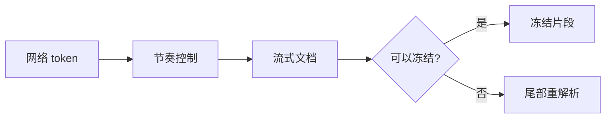

# StreamMark 演示

StreamMark 是面向 AI 对话的**高性能流式 Markdown** 渲染库：*原生绘制*、`NativeAOT`、~~WebView~~ 不需要。

## 数学公式

行内公式 $E = mc^2$，反斜杠写法 \(\alpha + \beta = \gamma\)，以及块级公式：

$$
\int_{-\infty}^{\infty} e^{-x^2}\,dx = \sqrt{\pi}
$$

\[
\begin{aligned}
\nabla \cdot \mathbf{E} &= \frac{\rho}{\varepsilon_0} \\
\nabla \times \mathbf{B} &= \mu_0 \mathbf{J} + \mu_0 \varepsilon_0 \frac{\partial \mathbf{E}}{\partial t}
\end{aligned}
\]

化学方程式：$\ce{2H2 + O2 -> 2H2O}$

## 代码

```csharp
public static async Task<int> CountAsync(IAsyncEnumerable<string> lines)
{
    var count = 0;
    await foreach (var line in lines)
    {
        if (!string.IsNullOrWhiteSpace(line)) count++;
    }
    return count;
}
```

```python
def fib(n: int) -> int:
    a, b = 0, 1
    for _ in range(n):
        a, b = b, a + b
    return a
```

## 图表



## 表格与列表

| 能力 | 状态 | 备注 |
|:-----|:----:|-----:|
| 流式解析 | ✅ | 冻结前缀 + 尾部 |
| 公式 | ✅ | RaTeX |
| 图表 | ✅ | Mermaid |

- [x] 跨消息选区
- [x] 虚拟化长会话
- [ ] 更多主题

> [!TIP]
> 选中任意文本后按 ⌘C 复制纯文本，⌘⇧C 复制 Markdown 源码。

脚注示例[^1]。

[^1]: 脚注内容会显示在文末。
